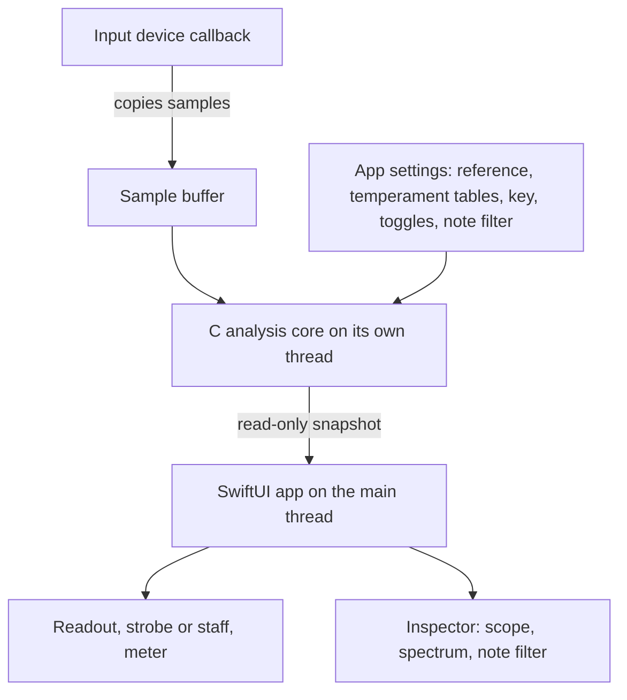
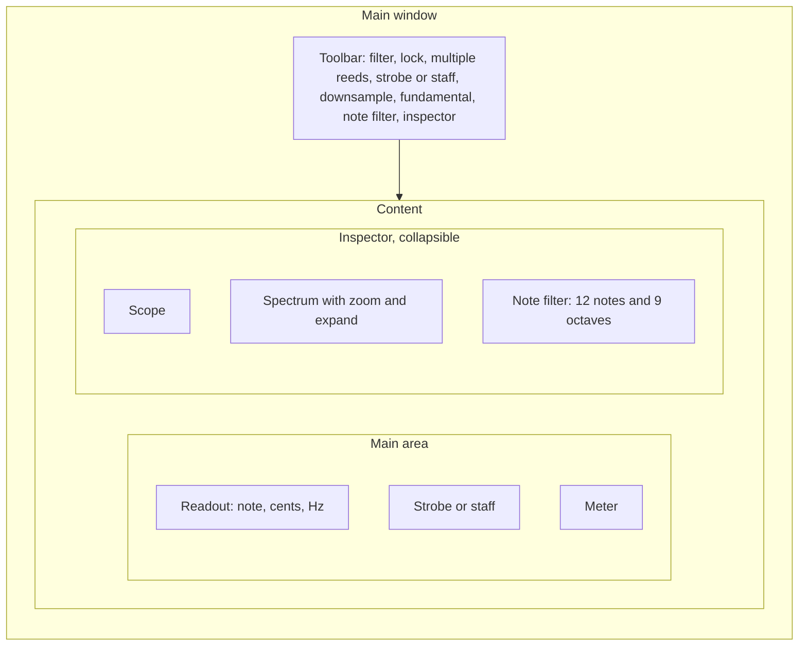
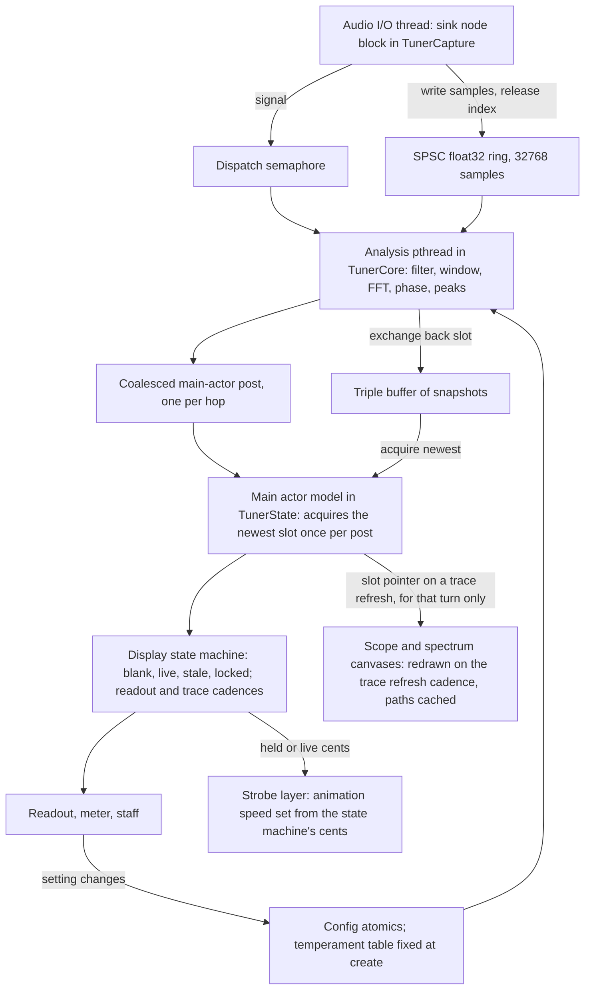
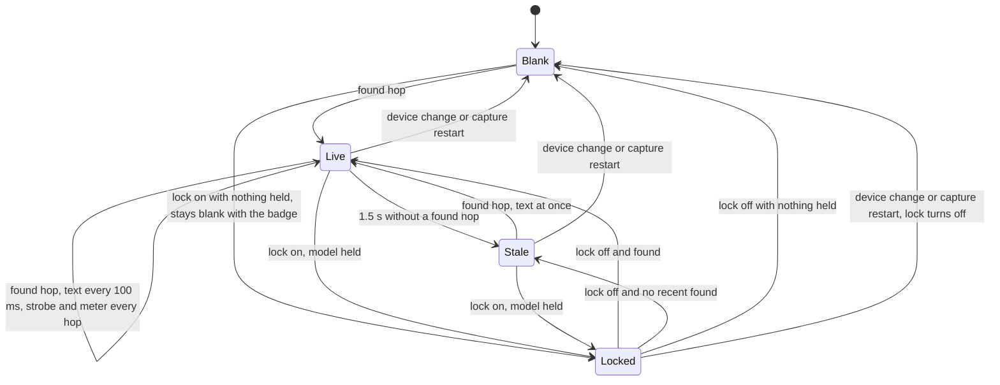
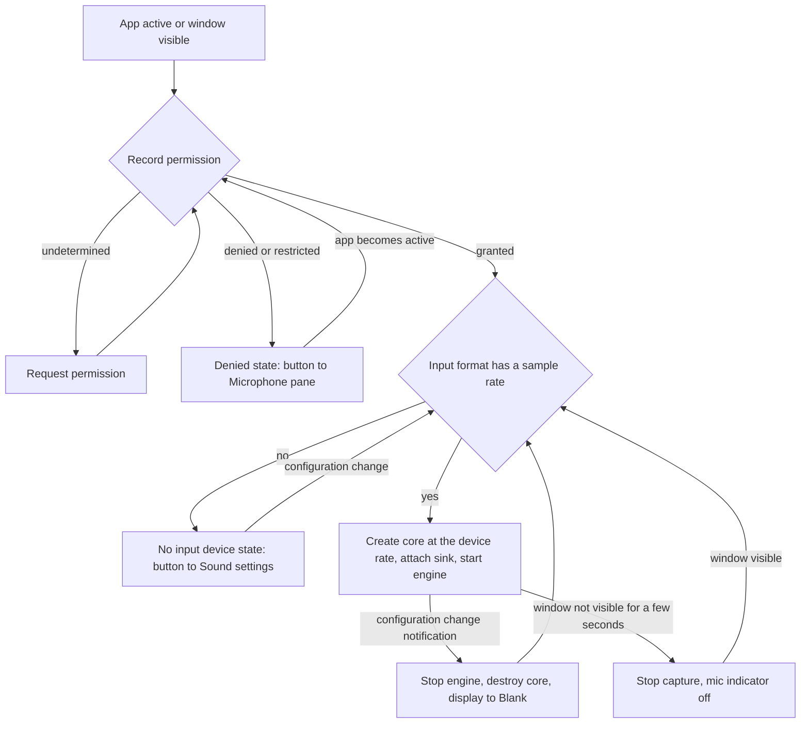
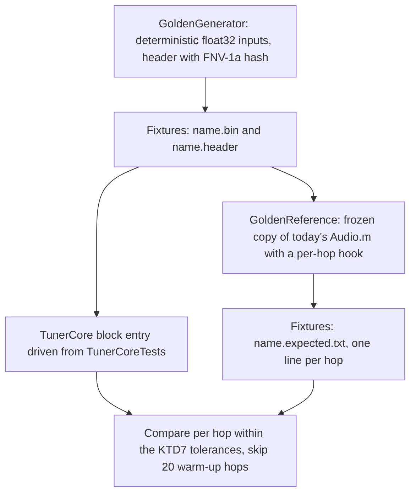
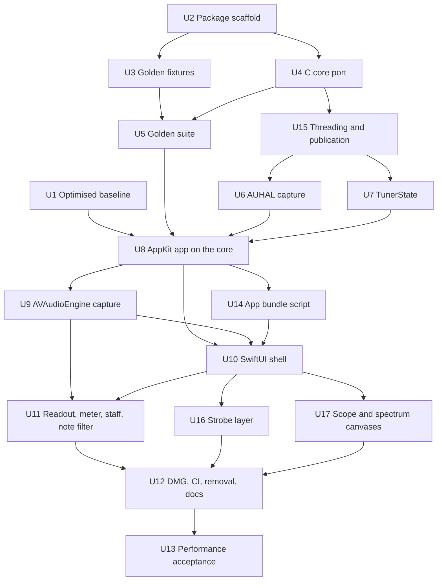

# Mac-Native Tuner Rewrite - Plan

## Goal Capsule

- **Objective:** The owner tunes with a Tuner that looks and behaves like Apple's own Mac apps, idles under 5% of one core, keeps a smooth strobe, and contains nothing that blocks a later build for the owner's own iPhone or iPad.
- **Means:** Stage 1 moves Bill Farmer's analysis engine into a plain C core with no Cocoa, running on its own thread and publishing a per-hop snapshot that the existing window reads (KTD3, KTD4, KTD5). Stage 2 replaces the window with a SwiftUI one and moves capture to AVAudioEngine (KTD8, KTD9). The code becomes a Swift package built with the Command Line Tools (KTD2).
- **Authority:** This plan supersedes the "not a rewrite", "no Xcode project or Swift Package", "no pure-Swift rewrite of the audio engine" and "resist a new toolchain" boundaries in `STRATEGY.md`. The owner chose that direction in the brainstorm; `STRATEGY.md` is rewritten as a follow-up. The strategy's metrics "Runs on latest macOS with mic permission" and "Tunes to a cent-offset target accurately" still hold. This plan's R-IDs own behaviour; its KTDs own mechanism.
- **Open blockers:** none.
- **Stop conditions:** stop and ask the owner if a golden fixture cannot be made stable without changing the analysis maths; if the macOS 26 CI runner cannot build the SwiftUI target; if following the default input device turns out to need code that cannot also run on iOS; or if any change to the bundle identifier or signing would lose the owner's saved settings or microphone grant.
- **Execution profile:** Two shippable stages. Stage 1 (U1 to U8 and U15) is an engine refactor behind golden tests, with no visible change beyond the accepted deltas listed in the Planning Contract. Stage 2 (U9 to U14, U16 and U17) is a new UI layer, a new capture layer and a new build on the same engine.
- **Finishes and ships:** Each stage lands through at least one pull request from a feature branch in a worktree, per the fork's workflow. The golden fixtures (U2, U3) may land first as their own PR so the refactor PR is reviewed against green goldens; stage 2 lands as several PRs with the stage 1 app and CI green throughout.

---

## Product Contract

### Summary

Rebuild the Mac tuner as a Swift package with two layers on one architecture: a C analysis core that owns its thread and publishes read-only snapshots, and a SwiftUI app that draws those snapshots in a tuner-first window with a toolbar, an inspector and a Settings window. Every capability of today's app survives, every setting persists, and the layering keeps an iOS build possible without touching the core.

### Problem Frame

The app is Bill Farmer's 2017 Swift port of a Carbon tuner. Its window is a bare titled window holding six panes in a column, and the owner reads it as a ported Linux app. Controls are single letter keys and a Preferences window. Nothing uses the toolbar, inspector or Settings patterns that current macOS apps share.

The engine's analysis runs on the main thread. `swift/Audio.m` dispatches the whole FFT, phase and peak pass to the main queue from the input callback, where it competes with drawing. Measured on the owner's Mac on 2026-10-16 with the mic open and nothing playing, the app used 21 to 25% of one core. A quarter of the busy samples were analysis, about 40% were CoreGraphics and CoreText drawing, and about a third were allocation and runtime churn. The FFT already runs on Accelerate, so a faster language would not move these numbers. Threading and drawing would. That profile was taken on a build with no optimisation flags, so the split is re-measured before the refactor (KTD13).

The engine and the UI share C globals. `swift/Audio.h` includes Cocoa and holds pointers to the six Swift views, and `ProcessAudio` sets view properties and `needsDisplay` directly. That coupling makes the engine unusable from any other UI, including an iOS one, and is why the parked Swift port in `swift/Audio.swift` never got past setup code.

### Key Decisions

- **The rewrite supersedes the no-rewrite boundaries in `STRATEGY.md`.** (session-settled: user-directed — chosen over keeping the Objective-C engine as-is behind a modernised shell, and over staying inside the existing strategy: the owner wants a Mac-native app and accepts the change of direction.) Governs R1, R23.
- **Performance targets replace a language mandate.** (session-settled: user-approved — chosen over a Rust engine for speed: the 2026-10-16 profile shows analysis is a minority of CPU and already runs on Accelerate, so threading and drawing are the cost.) Governs R2, R21, R22.
- **Every capability survives; presentation is free.** (session-settled: user-approved — chosen over strict layout parity and over dropping panes: the owner uses the free-reed features and wants a Mac-shaped window.) Governs R9 to R19.
- **A future iOS build targets the owner's own devices through Xcode, not the App Store.** (session-settled: user-directed — chosen over keeping App Store distribution possible: the code is GPLv3, and App Store terms are generally held to conflict with it.) Governs R24, R25.
- **The main window is tuner-first with an inspector.** (session-settled: user-directed — chosen over today's column with a toolbar and over two side-by-side columns, judged on wireframes.) Governs R9, R10.
- **C core plus SwiftUI shell, delivered in two stages.** (session-settled: user-approved — chosen over an all-Swift engine port now and over a Rust core: least change to proven DSP, the shape Apple's own Audio Unit template uses, and the owner's smallest valuable cut is the engine off the main thread.) Governs R1 to R6, R23.
- **The engine publishes snapshots; views never reach into the engine.** This removes the C globals and view pointers that couple `swift/Audio.m` to AppKit, and the same contract serves a later iOS UI. Governs R6, R7, R8.
- **Golden tests gate the engine refactor.** Today's engine's outputs on synthesized tones are captured first, so the threading and boundary changes are proven equal rather than ear-checked. Governs R3, R20.
- **Temperament tables are data the host passes in.** The strategy's deferred "editable temperaments and per-note cent offsets" feature then never reopens the engine. Governs R4.
- **Every setting persists.** Today nine keys persist and the rest reset on launch; a Mac app is expected to remember all of them. Lock is the exception and starts off. Governs R19.
- **Commands live in the menu bar with shortcuts, and the bare letter keys stay as aliases.** The HIG expects every toolbar action in the menu bar; the aliases keep the owner's muscle memory. Governs R16.
- **Swift package plus a bundling step, Command Line Tools only.** Verified on the owner's Mac on 2026-10-16: the macOS 27 SDK that ships with the Command Line Tools builds SwiftUI apps and runs Swift Testing, and XCTest is absent. Xcode is added only when the iOS target starts. Governs R23, R26.
- **Known-broken behaviour is fixed, not copied.** (session-settled: user-approved — chosen over "same as today" parity for the expand pop-up, the unzoomed spectrum markers, the multiple-reed rows, the first reed lost under lock, the staff click's stale checkbox and the empty note filter: copying them would pin bugs into acceptance examples.) Governs R7, R11, R12, R17, R29.
- **Device following and permission states are new behaviour.** (session-settled: user-approved — chosen over inheriting today's silent freeze: today's app binds the input device once, never follows a change, and treats a denied microphone as a quiet room.) Governs R5, R30, R31.
- **Transpose stays a display setting.** (session-settled: user-approved — chosen over passing transpose into the engine as the brainstorm's R4 said: today's engine never sees transpose, and golden captures would diverge if it did.) Governs R4, R9.
- **First-launch defaults and window lifecycle follow Mac conventions.** (session-settled: user-approved — chosen over today's accidental defaults, where the staff shows first, settings are written only at quit, full screen is disabled and capture runs from launch to quit: the owner wants a Mac-shaped app.) Governs R14, R19, R32 to R35.



### Requirements

**Engine core**

- R1. The analysis engine is a plain C library that depends only on the C standard library, POSIX threads, libdispatch and Accelerate, with no AppKit, Cocoa, Objective-C or Swift view references.
- R2. Analysis runs on a thread the engine owns; the audio input callback only copies samples into a buffer, and the main thread never runs analysis.
- R3. For the same input samples, sample rate and configuration, the engine produces the same results as today's `swift/Audio.m`: the 16384-sample FFT with 16 times overlap on a fixed 1024-sample hop, the phase-difference frequency estimate, the single-pole input filter whose corner is 480 Hz at 44.1 kHz (the README's 120 Hz figure is wrong), downsampling by harmonic product, the fundamental filter, the note filter, and up to 8 maxima with frequency, cents and note. The three undefined-behaviour sites in today's code are made defined without changing any golden output.
- R4. The engine takes its whole configuration through its interface as data: sample rate, reference frequency, the temperament tables and the selected temperament, key, filter, downsampling, fundamental filter, and the note filter's 12 note flags and 9 octave flags, which are two independent sets, not a matrix. Transpose is display state (R9).
- R5. The engine captures from the system default input device at the device's own sample rate without changing the device's nominal rate, and follows a change of default device or sample rate by restarting analysis with fresh history. Today's app does neither; this is new behaviour.

**Engine to UI contract**

- R6. The engine publishes a read-only snapshot per analysis hop holding a found flag, the primary note, cents, measured frequency and reference frequency, the maxima, the scope samples, the spectrum with its markers and a sequence number; the UI reads the latest snapshot at display cadence without blocking analysis.
- R7. Display lock is app state, not engine state: when locked, the readout, the multiple-reed rows, the spectrum markers, the meter and the staff hold their values and the strobe keeps animating from the held cents value, while analysis continues and the scope and spectrum traces keep moving; unlocking resumes live values.
- R8. The readout's note, cents and frequency update about ten times a second while a note holds, and at once when a note follows silence; the strobe and meter take every analysis hop.

**Main window**

- R9. The main window shows the readout, the strobe or the staff, and the meter, with the readout as the dominant element; the single-note readout carries the note with accidental and octave, the measured frequency as the dominant figure, the target frequency and the frequency deviation, with cents shown in the meter and in each multiple-reed row, and with transpose shifting the displayed note name and the staff position only.
- R10. An inspector, toggled from the toolbar and a View menu command, holds the oscilloscope, the spectrum with its zoom and expand controls, and the note filter; hiding it leaves a compact tuner window, and its visibility persists.
- R11. Multiple-reed mode shows up to 8 detected maxima in the readout, one row per maximum, with every row visible.
- R12. The spectrum keeps zoom, the expand factor from 1 to 16 in powers of two, the centre line and the markers for in-range maxima, with markers and labels landing on the trace in both the zoomed linear axis and the unzoomed logarithmic axis.
- R13. The strobe and the staff toggle in place, and the strobe keeps its selectable colour schemes.
- R14. The window is built from standard system components so it takes the system appearance, materials and window styling without custom chrome; it is resizable with a sensible minimum, allows full screen, and remembers its size and position.



**Settings and commands**

- R15. A Settings window on Command-comma holds the reference frequency, transpose, temperament, key and strobe colours; the toggles live in the toolbar and the View menu and are not duplicated in Settings.
- R16. Every action has a menu-bar command with a keyboard shortcut, and the bare letter keys keep working in the main window: `c` copies the readout, `d` toggles downsampling, `f` the filter, `k` the colours, `l` lock, `m` multiple reeds, `s` strobe or staff, `z` zoom, and `+` and `-` expand and contract the spectrum; the Print, Find, Spelling and Help items that do nothing today are not carried over.
- R17. Clicking a pane keeps today's meaning: the scope toggles the filter, the spectrum toggles zoom, the readout and the meter toggle lock, and the strobe and the staff toggle between each other; every control that mirrors a toggle shows the new state.
- R18. Copy readout puts the primary note, cents and frequencies on the clipboard as one line in the format today's `c` key produces, from the `c` key and from Command-C; in multiple-reed mode it still copies the primary line; a stale or locked reading copies, and in the blank state, before any reading, it copies nothing.
- R19. Every setting and toggle persists across launches and is written when it changes, including multiple reeds, the fundamental filter, the note filter with its note and octave picks, expand and the inspector's visibility; lock starts off on every launch; the nine keys today's app writes under `org.billthefarmer.Tuner` are read when the new keys are absent, so the owner's settings carry over.

**Performance**

- R20. A golden test suite captures today's engine's outputs for synthesized inputs, covering pure tones across the range, detuned tones, two close tones beating, and low tones with downsampling; the refactored engine passes it within a tolerance planning sets, defaulting to bit-identical for the C refactor.
- R21. While listening with no instrument playing, the app uses under 5% of one core, measured the way the 2026-10-16 baseline was.
- R22. The strobe animates at the display's refresh rate without dropped frames, its per-frame path runs no app code and allocates no heap memory, and every other pane redraws only when its data changes.

**Build, project and portability**

- R23. The Mac app builds from a fresh checkout with only the Command Line Tools: a Swift package plus a bundling step produce `Tuner.app` and the DMG, with no Xcode project.
- R24. The engine and the shared app state are package targets that import no AppKit; platform-specific code is confined to the Mac app target.
- R25. Audio capture uses APIs that exist on iOS as well as macOS, so the engine package can run under an iOS app without a second capture implementation.
- R26. CI builds the Mac app and runs the engine tests on `macos-latest`; the Linux job stays as it is.
- R27. The app keeps ad-hoc signing and the existing microphone usage description.

**Documentation**

- R28. The user-facing README lists every command, shortcut and click accurately, fixing the `c` and `k` mix-up and documenting `+` and `-`; `AGENTS.md` describes the new layout and build.

**Device, permission and lifecycle**

- R29. The note filter defaults to all 12 notes and all 9 octaves enabled, and an empty selection behaves as no filter, so enabling the filter never blanks the readout.
- R30. The app requests microphone permission before capture starts; when permission is denied or restricted, the window shows a state that says so with a button that opens the Microphone pane of Privacy & Security, and the app re-checks the permission when it becomes active.
- R31. When no input device is available, the window shows a state that says so and capture resumes by itself when a device appears; during a device change the display is in the blank state until the new device delivers samples.
- R32. First launch shows the strobe rather than the staff and hides the inspector.
- R33. The reference frequency field accepts 300 to 500 Hz, commits on Enter or focus loss, and never stores 0.
- R34. Closing the last window quits the app; capture pauses a few seconds after the window stops being visible and resumes when it is visible again, so the microphone indicator tracks visibility.
- R35. With no note detected the readout, staff and meter hold the last reading and grey it after 1.5 seconds, and the strobe stops; before any first reading the readout is blank, the staff draws no note head and the meter sits at centre.

### Key Flows

- F1. Launch and tune
  - **Trigger:** The owner opens Tuner.
  - **Steps:** On first launch macOS asks for microphone access with the existing description. The engine starts capturing from the default input. The owner plays a note; the readout shows note, cents and frequency, and the strobe or staff and the meter follow the cents. The owner opens the inspector to see the spectrum's reeds, then closes it.
  - **Outcome:** Tuning with no analysis stall, in a window that stays compact unless the inspector is open.
  - **Covers:** R5, R6, R8, R9, R10, R14, R30.
- F2. Lock, copy, unlock
  - **Trigger:** The owner wants to keep a reading.
  - **Steps:** Lock from the toolbar, the `l` key or a click on the readout. The readout, meter and staff hold while the strobe keeps animating. Copy readout puts the values on the clipboard. Unlock resumes live values.
  - **Covers:** R7, R16, R17, R18.
- F3. Tune one reed with the note filter
  - **Trigger:** The owner tunes an accordion reed in a specific octave.
  - **Steps:** Open the inspector, enable the note filter, pick the note and the octave. The engine ignores other maxima. Multiple-reed mode shows the reed set. The picks are there again next session.
  - **Covers:** R4, R10, R11, R19, R29.
- F4. Input device unplugged and replaced
  - **Trigger:** The owner's USB interface is unplugged mid-session, then a different device becomes the default input.
  - **Steps:** The window shows the no-input-device state. The owner plugs in another interface or picks one in System Settings. Capture restarts at the new device's sample rate with fresh analysis history, the readout clears to blank, and the next note shows.
  - **Outcome:** No dead window, no stale reading from the old device.
  - **Covers:** R5, R31, R35.
- F5. Microphone denied
  - **Trigger:** The owner clicks Don't Allow on the permission prompt, or revokes access later in Privacy & Security.
  - **Steps:** The window shows the permission-denied state with a button to the Microphone pane. The owner grants access there and returns to Tuner. The app re-checks on activation and starts capture.
  - **Outcome:** Silence is never mistaken for a quiet room.
  - **Covers:** R30.

### Acceptance Examples

- AE1. **Covers R3, R20.** Given the golden input set and its captured outputs from today's engine, When the refactored C core processes the same inputs with the same configuration, Then every maxima frequency, cents value and note matches within the tolerance.
- AE2. **Covers R2.** Given the app listening under a profiler, When any note plays, Then no analysis function appears on the main thread's stacks.
- AE3. **Covers R21.** Given the app listening in silence for 60 seconds with the inspector hidden, Then the process averages under 5% of one core.
- AE4. **Covers R7.** Given A4 showing at +3 cents, When lock is on and a different note plays, Then the readout, meter and staff still show A4 at +3 cents and the strobe keeps moving at the held rate; When lock turns off, Then the new note shows.
- AE5. **Covers R19.** Given multiple reeds on, the fundamental filter on, the note filter set to A in octave 4, expand at 4 and lock on, When the app relaunches, Then multiple reeds, the fundamental filter, the note filter and expand are restored and lock is off.
- AE6. **Covers R10.** Given the inspector hidden, When the app relaunches, Then the window opens compact with the inspector hidden; When the owner presses the inspector toolbar button, Then the scope, spectrum and note filter appear.
- AE7. **Covers R4, R11.** Given the note filter set to only A in octave 4, multiple reeds on and downsampling off, When C5 plays, Then the readout does not show C5. With downsampling on, today's maths takes the primary reading from the product spectrum before the note filter applies, and R3 preserves that.
- AE8. **Covers R23.** Given a fresh clone on a Mac with only the Command Line Tools, When the documented build command runs, Then `Tuner.app` and the DMG are produced and the app launches.
- AE9. **Covers R30.** Given microphone access denied in Privacy & Security, When the app launches, Then the window shows the permission-denied state and its button opens the Microphone pane; When access is granted there and the app becomes active, Then capture starts and a played note shows.
- AE10. **Covers R5, R31.** Given the app tuning on a USB interface, When the interface is unplugged, Then the window shows the no-input-device state within a second; When the built-in microphone becomes the default input, Then capture restarts at its sample rate and the next note shows.
- AE11. **Covers R29.** Given a fresh install, When the owner enables the note filter without picking any note or octave, Then a played A4 still shows.
- AE12. **Covers R35.** Given A4 showing, When the note stops, Then the reading stays for 1.5 seconds and then turns grey with the strobe stopped; When a note plays again, Then the readout updates at once.

### Success Criteria

- The owner judges the window against Apple's own apps and accepts it; the window uses the system toolbar, inspector and Settings patterns and follows the system appearance.
- Idle CPU is under 5% of one core (R21), the strobe runs at the display's refresh rate (R22), and input-to-display latency is no worse than today's one analysis hop, about 23 ms at 44.1 kHz, plus one frame.
- The strategy metric "Tunes to a cent-offset target accurately" still holds: against a generated reference tone, the displayed cents are within tolerance for the chosen temperament.
- The golden suite (R20) runs green in CI (R26).

### Scope Boundaries

**Deferred for later**

- A Swift port of the engine, as its own plan once the golden tests exist.
- The iOS app itself; only the layering that keeps it possible is in scope.
- Editable temperaments and per-note cent offsets, the strategy's named feature; R4 keeps the engine ready for it.
- Applying the sandbox entitlement, which would need the audio-input key.
- The `STRATEGY.md` rewrite, a follow-up through the strategy skill before planning starts.

**Out of scope**

- A Rust engine.
- App Store or TestFlight distribution, notarization, and Developer ID signing.
- New pitch-detection algorithms or any change to the analysis maths.
- The `linux/` and `mac/` directories and the generated `docs/` site, which stay untouched.
- `swift/Audio.swift`, the unfinished Swift port, which is deleted rather than continued.
- Localisation, a menu-bar extra, and multiple windows.

**Deferred to Follow-Up Work**

- A stable self-signed certificate so the microphone grant survives rebuilds; today every ad-hoc build gets a new code hash, and whether that re-prompts is unverified.
- A noise gate for quiet instruments in noisy rooms; the note filter limited to the instrument's octaves is the workaround PR #2 recorded.
- Spectrum decimation inside the core so the snapshot shrinks and iOS gets the same display-ready array; stage 2 decimates in the Swift layer.
- The iOS-side audio session setup (`AVAudioSession` category and measurement mode), which cannot be compiled on this Mac.

**Considered and not built**

- A resampler inside the core. The core takes the device rate and keeps a fixed 1024-sample hop; a device whose rate makes the 16384-sample window unsuitable for the owner's instruments would change this.
- A watchdog that restarts capture on callback overruns. The ring counts overruns and the analysis thread resets its phase history; measured drops in practice would change this.
- Joining the analysis thread to the device's audio workgroup. Apple states non-real-time threads cannot join; a measured scheduling delay despite user-initiated QoS would change this.
- Replacing the temperament table while the engine runs. Nothing in R1 to R35 edits the table; the engine takes it at create and only the selected index changes at runtime. The deferred editable-temperaments feature can add a setter or recreate the engine when it is planned.
- The hardened runtime and an entitlements file on the bundle. Today's linker-signed app with no entitlements captures audio, and notarization is out of scope; a missing or wrong entitlement would terminate the app on first capture. Notarization or the deferred sandbox work would change this.
- All and None buttons for the note filter grid. With every note and octave on by default (R29), narrowing to one note takes about 19 clicks; if that proves tiresome in practice, two buttons per group make it three.

### Dependencies and Assumptions

- Minimum macOS is 26 (KTD1); the owner runs macOS 27. GitHub's `macos-latest` runner has been macOS 26 with Xcode 26.6 since June 2026, so macOS 26 APIs build in CI and macOS 27 APIs would not.
- The Command Line Tools alone (Swift 6.4, Apple clang 21, macOS 27 SDK) build SwiftUI apps and run Swift Testing; verified on the owner's Mac on 2026-10-16. XCTest, `xcodebuild`, `actool`, `xcrun metal` and the iOS SDK are absent. `@State` and `@Entry` do not compile because the SwiftUI macro plugin is missing; `typealias LocalState<V> = SwiftUI.State<V>` works. `swift test` fails about half the time unless the Testing plugin path is passed explicitly.
- Baseline of 2026-10-16: 21 to 25% of one core while idle, with the profile split given in the Problem Frame, taken on an unoptimised build that may have predated the draw fix in `c86f560`; U1 re-measures.
- The `TimelineView(.animation)` layout-churn bug (Apple Developer Forums thread 773682, FB13810482) reproduces only when SwiftUI hosts AppKit hosting SwiftUI; a whole-window SwiftUI app and a plain AppKit window hosting SwiftUI are clean on macOS 27.
- `AVAudioSinkNode`'s realtime-safe initializer (macOS and iOS 27) is marked unavailable to Swift; an Objective-C target can call it. Any Swift closure handed to an audio node must be formed in a nonisolated context or Swift 6 traps on the audio thread.
- Outputs of today's engine built at `-O0`, `-O3` and with `-ffp-contract` on or off differ by at most 5.8e-15 relative in derived frequencies, and never in found, note or count.
- The licence stays GPLv3; a straight port of the engine is fine for own-device use.
- Today's engine requests 1024-frame callbacks at 44100 Hz; the phase maths is only right for a 1024-sample hop, so the golden fixtures pin 44.1 kHz and the core fixes the hop (R3).
- PR #2 (merged 2026-10-17) owns the readout and meter design the rewrite inherits: Hz as the big number in single-note mode, cents only in the meter, a centre bar green within 5 cents, text about ten times a second, meter and strobe every hop, hold-then-grey on silence, blank before the first note.

### Outstanding Questions

Every question the brainstorm deferred to planning is settled: drawing path per pane (KTD9), strobe motion stays cents-driven (KTD9), readout cadence and smoothing (KTD10), golden tolerance (KTD7), repo layout and the Makefile (KTD2), the bundling step (KTD12), the C core's file shape (KTD3), minimum macOS (KTD1). Nothing blocks implementation; implementation-time unknowns are listed in the Planning Contract.

<!-- ce-section: work-relationships -->
### How This Work Fits Together

This plan covers the Mac rewrite in its two stages. The surrounding breakdown is the current understanding, not a committed roadmap.

- `STRATEGY.md` rewrite. Can proceed independently of this plan; enables planning to start from a strategy that agrees with it.
- Swift engine port. Depends on R1 to R6 and R20; shares the snapshot contract; still to decide whether it is wanted at all.
- Editable temperaments and per-note cent offsets. Depends on R4 and R15.
- iOS app. Depends on R24 and R25; still to decide when.

### Sources and Research

- Code: `swift/Audio.m` (`InputProc` and its filter, the main-queue dispatch, `ProcessAudio` with its first-call setup, candidate scan, selection, temperament adjust and publish gating); `swift/Audio.h` (Cocoa include, view pointers, globals defined in a header); `swift/AppDelegate.swift` (nibless menu, 20 ms timer, Preferences and note-filter windows, the nine persisted keys); `swift/TunerView.swift` (key handling and the copy format); `swift/StrobeView.swift` and `swift/MeterView.swift` (per-draw motion and smoothing); `swift/SpectrumView.swift` (marker mapping); `swift/DisplayView.swift` (multiple-reed row placement); `swift/StaffView.swift` (glyph tables, transpose octave); `swift/Temperaments.h` (32 rows, row 8 is equal temperament, rows 6 and 7 are absolute Hz); `swift/Makefile` (no optimisation flags); `swift/Info.plist`; `swift/Tuner.entitlements` (sandbox, no audio input); `.github/workflows/build.yml`.
- PR #2 "Make the tuner display faster to follow and easier to read" (merged 2026-10-17): the readout and meter design, `kDisplayCount = 4`, the `stale` flag, and `docs/solutions/ui-bugs/appkit-views-draw-at-window-size-from-dirtyrect.md`.
- Measurement: `top` and `sample` on the Tuner 1.09 arm64 build, 2026-10-16; SwiftUI `Canvas`, Core Animation and display-link costs measured on the owner's Mac the same day; `malloc_history` allocation counts per frame.
- Prior plan: `docs/plans/2026-10-16-1339-fix-mac-build-current-toolchain-plan.md`.
- Apple: Adopting Liquid Glass (https://developer.apple.com/documentation/technologyoverviews/adopting-liquid-glass); HIG Settings (https://developer.apple.com/design/human-interface-guidelines/settings); HIG Toolbars (https://developer.apple.com/design/human-interface-guidelines/toolbars); HIG Keyboards (https://developer.apple.com/design/human-interface-guidelines/keyboards); WWDC26 session 272 (https://developer.apple.com/videos/play/wwdc2026/272/); `AVAudioSinkNode` realtime-safe initializer (https://developer.apple.com/documentation/avfaudio/avaudiosinknode/initwithrealtimesafereceiverblock:); `AVAudioEngineConfigurationChangeNotification` (https://developer.apple.com/documentation/avfaudio/avaudioengineconfigurationchangenotification); `AVAudioApplication.requestRecordPermission` (https://developer.apple.com/documentation/avfaudio/avaudioapplication/requestrecordpermission(completionhandler:)); Requesting authorization to capture media (https://developer.apple.com/documentation/avfoundation/requesting-authorization-to-capture-and-save-media); `NSWindow.didChangeOcclusionStateNotification` (https://developer.apple.com/documentation/appkit/nswindow/didchangeocclusionstatenotification); `NSView.displayLink` (https://developer.apple.com/documentation/appkit/nsview/displaylink(target:selector:)); `Canvas` and `TimelineView` (https://developer.apple.com/documentation/swiftui/canvas, https://developer.apple.com/documentation/swiftui/timelineview); `State` macro note (https://developer.apple.com/documentation/swiftui/state); the `TimelineView` layout bug (https://developer.apple.com/forums/thread/773682); Energy Efficiency Guide for Mac Apps, Timers and QoS (https://developer.apple.com/library/archive/documentation/Performance/Conceptual/power_efficiency_guidelines_osx/Timers.html, https://developer.apple.com/library/archive/documentation/Performance/Conceptual/power_efficiency_guidelines_osx/PrioritizeWorkAtTheTaskLevel.html); Tuning your code's performance for Apple silicon (https://developer.apple.com/documentation/apple-silicon/tuning-your-code-s-performance-for-apple-silicon); Addressing architectural differences in macOS code, float-to-int (https://developer.apple.com/documentation/apple-silicon/addressing-architectural-differences-in-your-macos-code); WWDC20 Meet Audio Workgroups (https://developer.apple.com/videos/play/wwdc2020/10224/); the Audio Unit template's Swift UI with C++ DSP shape (https://developer.apple.com/documentation/avfaudio/creating-an-audio-unit-extension); Swift Testing parallelization (https://developer.apple.com/documentation/testing/parallelization); SwiftPM C targets, SE-0038 (https://github.com/swiftlang/swift-evolution/blob/main/proposals/0038-swiftpm-c-language-targets.md); SE-0410 Atomics (https://github.com/swiftlang/swift-evolution/blob/main/proposals/0410-atomics.md).
- Community: Rigtorp, Optimizing a ring buffer for throughput (https://rigtorp.se/ringbuffer/); Doumler, Using locks in real-time audio processing, safely (https://timur.audio/using-locks-in-real-time-audio-processing-safely); Mozilla cubeb triple buffer (https://searchfox.org/mozilla-central/source/media/libcubeb/src/cubeb_triple_buffer.h); Gitarstemmer, a SwiftUI tuner built with the Command Line Tools (https://github.com/espenbjork/Gitarstemmer); ChitarraTune, engine as a local Swift package tested with `swift test` (https://github.com/gpicchiarelli/ChitarraTune); GitHub Actions runner images (https://github.com/actions/runner-images).

---

## Planning Contract

**Product Contract preservation:** changed: R3 (480 Hz corner, fixed hop, undefined behaviour made defined), R4 (transpose out, sample rate in, flag sets named), R5 (device following is new, no rate forcing), R6 (per-hop snapshot carries a found flag and the primary values), R7 (lock holds the whole display model; scope and spectrum traces keep moving), R8 (cadence inherits PR #2), R9 (transpose is display-only), R10 (zoom and expand live in the inspector), R11, R12 and R17 (broken behaviour named and fixed), R14 (full screen), R16 (inert menu items dropped), R18 (Command-C, idle copy), R19 (write on change, legacy keys migrate), R22 (per-frame rule applies to the strobe), AE7 (scoped to downsampling off). Added R29 to R35, F4, F5, AE9 to AE12, four Key Decisions and a Deferred to Follow-Up Work subsection; the Outstanding Questions deferred to planning are resolved into KTDs. The owner confirmed every change in the scoping synthesis on 2026-10-16. Document review then clarified R18 (the blank state is the only state that copies nothing) and R31 (blank, not "idle") without changing their meaning, and added three considered-and-not-built entries.

### Key Technical Decisions

- KTD1. **Minimum macOS 26, package tools-version 6.2.** (session-settled: user-directed — chosen over macOS 27: GitHub's `macos-latest` runner is macOS 26 with Xcode 26.6, so macOS 27-only APIs would not build in CI, and R26 needs CI to build the app.) Sets `platforms` in `Package.swift`, `LSMinimumSystemVersion`, and the compile-time and run-time guards in KTD8's capture shim.
- KTD2. **One Swift package at the repo root builds everything, including the stage 1 AppKit app; a root Makefile wraps it; `swift/` keeps only its bundle and DMG rules until stage 2 deletes it.** Targets: `TunerCore` (C, the DSP), `TunerCapture` (Objective-C, the capture layer, a leaf that takes a C push callback and does not depend on the core), `TunerState` (Swift, no AppKit: engine wrapper, display state machine, settings), `TunerAppKit` (stage 1 only: the existing AppKit app as an executable target whose path is `swift`, with an explicit source list and Swift 5 language mode, depending on `TunerState` and `TunerCapture`), `TunerApp` (SwiftUI executable, stage 2), `GoldenGenerator` and `GoldenReference` (executables that produce the fixtures; the reference is macOS-only and its source is guarded so a whole-package iOS build skips it), `TunerCoreTests` and `TunerStateTests`. Dependencies point one way: app to state to core and capture; nothing depends upward. The three library targets are also `.library` products so an Xcode iOS project can depend on them without the executables (R24). No target uses unsafe compiler flags, because a package carrying them cannot be consumed as a dependency; the function-effects check (KTD4), the contraction policy (KTD15) and the generator's optimisation level are set by pragmas and attributes in source. The root `Makefile` wraps `swift build`, `swift test` with the Testing plugin flag (KTD14) in debug and release, fixture regeneration, the sanitizer runs, the bundle script and `dmg`. Through stage 1 `swift/Makefile` loses its compile lines and keeps the icon, bundle and DMG rules, copying the `TunerAppKit` binary from the package's release build, so the shipped objects are the golden-tested objects and the stage 1 app, like the package, requires macOS 26. Chosen over compiling the package sources a second time from the Makefile (two language modes, two deployment floors, two optimisation levels and a module boundary never exercised) and over keeping the C core inside `swift/` with make-only tests (Swift Testing and `Bundle.module` fixtures need the package, and the package is what the iOS build imports).
- KTD3. **The C core is an opaque handle with no globals and no logging.** Every function-scope static in `ProcessAudio` and `InputProc` (`xa`, `xp`, `xq`, `xf`, `x2` to `x5`, `dxa`, `dxp`, `maxima`, `values`, `window`, `input`, `re`, `im`, the FFT setup, `fps`, `expect`, `dmax`, the filter state) becomes a field of the handle, allocated once at create and freed at destroy, so two engines can exist in one test process and an engine can be recreated at a new sample rate. The handle offers create, start, stop and destroy, status codes with a string accessor, and a synchronous entry that processes one 1024-sample block into a snapshot on the caller's thread, which the golden tests and the analysis thread both use. The temperament table is passed in as 32 rows of 12 doubles (R4). The public header defines no fixed-size arrays in structs (the Swift importer turns them into tuples), uses bitmasks for the note and octave flags, and keeps the pointer-bearing snapshot view non-Sendable. The legacy `vDSP_create_fftsetupD` and `vDSP_fft_zripD` stay: they are not deprecated, and a different transform would break the goldens. Rate-dependent constants (`fps`, `expect`, the filter coefficients) are derived from the sample rate given at create; at 44100 the literal coefficients from today's code are used so the goldens match exactly.
- KTD4. **The capture callback copies into a wait-free single-producer ring; one analysis pthread consumes fixed 1024-sample hops.** The callback writes float32 samples, release-stores the write index and signals a dispatch semaphore; nothing else, no allocation, no lock, no log. The push function is annotated `nonblocking` and the core turns on clang's function-effects warning from a source pragma guarded by attribute availability, so the owner's clang 21 checks the callback path and an older clang compiles the same files silently; the semaphore signal is the one audited exception, wrapped in a single function under a diagnostic pragma with a comment. The analysis thread, created with user-initiated QoS, waits on the semaphore, widens the hop to double, applies the input filter in sample order, and runs one analysis pass per complete 1024-sample hop in a catch-up loop, so callback sizes other than 1024 no longer corrupt the phase maths (R3). Overrun policy: the writer drops the block, bumps an atomic counter, and the analysis thread resets its phase history when the counter changes. Shutdown sets a stop flag, signals, joins. Chosen over analysis in the callback (today's main-queue dispatch and its stalls), over a timed poll (Apple's energy guidance prefers indefinite waits), and over a real-time workgroup thread (Apple states non-real-time threads cannot join one). Moving the filter from the callback to the analysis thread preserves the sample order and the filter state, so goldens hold.
- KTD5. **Snapshots are published through a wait-free triple buffer with one consumer.** A slot holds the sequence number, sample rate, found flag, note, cents, measured and reference frequency, count, the 8 maxima, the newest 8192 input samples for the scope (today's scope reads up to five times its width in samples from an 8192-sample window) and the 7168 spectrum bins, about 122 KB written 43 times a second. The analysis thread computes the spectrum directly into its back slot and exchanges it into the middle with a dirty bit. The main-actor model is the single consumer: a coalesced post per hop wakes it, it acquires the newest complete slot once, feeds the display state machine, and hands the same pointer to the scope and spectrum views for that turn only; those views cache the decimated paths they build and never keep the pointer, because the slot is reused after the next acquire. The model acquires on every post so the state machine sees every hop, but the scope and spectrum redraw only on the display model's trace refresh cadence (KTD10). The strobe and meter take cents from the state machine, not from the slot, so they hold under lock (R7) and see every hop (R8) because the model runs per hop. Chosen over a mutex (blocks a side), a seqlock (a formal data race and a spinning reader when the writer is preempted), and a separate per-frame atomic for the strobe (no per-frame reader exists once the strobe is a layer animation, and it would bypass lock).
- KTD6. **Configuration flows from the UI to the engine as relaxed atomics; the temperament table is fixed at create.** Reference, key, temperament index and the toggles are individual atomics; the note and octave flags are two atomic bitmasks; the 32-row table is supplied at create (KTD3) and is immutable for the engine's life, so the core holds no lock and no generation counter. The audio callback reads none of it. Transpose never reaches the engine (R4). Chosen over a replaceable table under a lock with a per-hop copy: nothing in R1 to R35 edits the table at runtime, and the deferred editable-temperaments feature can add a setter or recreate the engine when it is planned.
- KTD7. **Golden tests compare per-hop records against committed fixtures captured from a frozen copy of today's engine, within a tolerance.** (session-settled: user-approved — chosen over an in-process differential test against the unmodified `Audio.m` and over bit-identical comparison: the per-hop values exist only as locals inside `ProcessAudio`, so either design needs a hook in a copy; committed fixtures make CI independent of the reference build; and measured sensitivity to compiler flags, up to 5.8e-15 relative, rules out bit-identical across builds.) Gate: exact equality for found, note, count and each maximum's note; relative 1e-12 for frequencies, reference frequencies, the peak magnitude and the spectrum digest; absolute 1e-9 for cents, which the engine stores in semitones. A separate same-binary-twice check demands exact equality. The first 20 hops of every fixture are skipped as warm-up. Fixtures pin 44100 Hz, 1024-sample blocks, lock off, and a configuration header; inputs are float32 files produced by a deterministic generator with an FNV-1a hash in the header, so a libm change shows as "input changed", not "engine changed". The suite runs in debug and release so the shipped optimisation level is the tested one. The fixture set and format are U3's. R20's "defaulting to bit-identical" is superseded by this tolerance for the reasons above.
- KTD8. **Stage 1 keeps today's AUHAL capture behind a C capture interface; stage 2 replaces it with AVAudioEngine and a sink node through an Objective-C shim and stops forcing 44.1 kHz.** (session-settled: user-approved — chosen over rewriting capture in stage 1: stage 1 is judged by the golden gate and "no visible change", and today's capture is the least change behind it.) The capture interface is create with a C push callback and context, start, stop, destroy, a status query and a sample-rate query; the capture target depends on nothing in the package. Stage 1's implementation ports `SetupAudio`, `InputProc` and `ShutdownAudio` with the dispatch, the log call and the filter removed, keeps the nominal-rate forcing, fixes the buffer-size loop that never terminates when the device minimum exceeds 1024, and disposes the unit on failure. Stage 2's implementation attaches a sink node to the engine's input node at the hardware format, observes the configuration-change notification and restarts capture and the core at the new rate with fresh history, checks for a usable input by the input format's sample rate, and never touches the engine's output or mixer nodes. The realtime-safe initializer, its block type and the realtime annotation exist only in the macOS 27 SDK, and CI compiles against SDK 26, so the shim selects them at compile time by SDK version and attribute availability and again at run time by `@available`: CI's build, which is the DMG CI ships, uses `initWithReceiverBlock:`; the owner's local build gets the realtime-safe path; Swift never forms either block. AUHAL is macOS-only, so R25 is met only in stage 2.
- KTD9. **Drawing path per pane: Core Animation for the strobe, `Canvas` on the trace refresh cadence for scope and spectrum, plain SwiftUI for readout, meter and staff; everything pauses on occlusion.** (session-settled: user-approved — chosen over a `Canvas` inside `TimelineView(.animation)` for the strobe and over Metal: the Canvas strobe measured 11 to 13% of a core at 120 Hz with over 100 allocations per frame, a Core Animation layer animation about 0% and no allocations, and Metal shaders cannot be compiled offline with the Command Line Tools.) The strobe is a layer-backed `NSViewRepresentable` whose four bands move by a repeating additive layer animation; app code runs only when the state machine's smoothed cents value changes the animation's speed, and every speed change rebases the animation's begin time and time offset from the presentation layer's current offset so the pattern position is continuous, including when the sign changes. The layer has today's three looks: plain bands, a gradient above 20 cents, a flat fill above 40 cents. Motion is time-based: today's view advances the pattern by 50 times its smoothed value, which is in semitones, per redraw at 50 Hz, so the layer moves 25 points per second per cent, and today's per-redraw smoothing becomes a 160 ms time constant, so the feel matches today on any refresh rate. The strobe stays cents-driven; a signal-phase-driven strobe would need per-frame drawing. Scope and spectrum redraw on the display model's trace refresh cadence (KTD10), which defaults to today's every sixteenth hop, about 2.7 times a second, never on a timeline; they cache their paths between refreshes and the spectrum is decimated to two points per pixel column before stroking. Readout, meter and staff are ordinary SwiftUI views driven by the display model: the meter's cents pass through an 80 ms time-based smoother inside the display model (today's three-quarters-per-redraw factor at 50 Hz) and the bar is set per hop with no SwiftUI animation, so no app code runs per frame and the pane redraws only when its data changes (R22). Readout, meter and staff draw with semantic system colours on the window background (primary and secondary labels, system green and orange for the meter, grey for stale) so they follow light and dark appearance (R14); scope, spectrum and strobe keep fixed instrument colours in both appearances. AppKit's window occlusion state and app hide are exposed to the model as one Boolean that pauses the strobe animation, the snapshot reads and, after a few seconds, capture (R34); `TimelineView` is not used because it keeps running when occluded.
- KTD10. **The display state machine and the settings model live in `TunerState`, platform-free, and are written in stage 1.** States: blank (no reading yet), live, stale (1.5 seconds without a found hop, defined in time, not hops) and locked, which holds the whole display model including the maxima rows and spectrum markers (R7). Readout text updates at once on the stale-to-live and blank-to-live transitions and then every 100 ms while live (PR #2's four hops); the strobe and meter take every hop while live and hold under lock; when stale the strobe gets 0 and the meter holds its last value, greyed (R35). Other outputs: the meter's in-tune flag (5 cents inclusive, as PR #2 draws it), the meter's 80 ms smoother, and a trace refresh flag that fires every sixteenth hop by default, today's cadence, and drives the scope and spectrum redraws in both stages. Lock pressed in the blank state stays blank with the lock badge; unlock with nothing held returns to blank; a device change or capture restart clears the held model, turns lock off and returns to blank (R31). Copy readout returns the current or held line in the live, stale and locked states and nothing in blank (R18). Time is an input to the machine so tests inject it. The settings model owns every R19 setting, writes `UserDefaults` on change under the unchanged bundle identifier `org.billthefarmer.Tuner`, reads the nine legacy keys (`Ref`, `Temper`, `Key`, `Trans`, `Colours`, `Zoom`, `Filter`, `Strobe`, `Down`) when its own keys are absent, drops the `Ref == 0` first-launch sentinel, clamps indices (temperament 0 to 31, key 0 to 11, transpose 0 to 12, colour 0 to 2) and enforces R33. Temperament stays index-keyed to keep the owner's saved choice; the table order is therefore frozen. The copy-readout formatter (R18) lives here too so it is tested. Chosen over keeping the hold and cadence counters in the engine: they are coupled to lock today, and R7 needs lock outside the engine.
- KTD11. **Menu commands carry the bare letters as their shortcuts.** Verified on this toolchain: a menu item with a bare-letter shortcut fires on the key and yields to a focused text field. One binding serves R16's menu command and its alias, with no second modifier scheme to document. The View menu holds the pane toggles and the inspector command, as R10 and R15 say, with Command-Option-I on the inspector, Apple's convention; a Tuner menu holds copy readout, lock, the colour cycle and expand. Edit > Copy in the main window performs copy readout, which gives R18 its Command-C. Chosen over a Command-Option scheme, which would double the bindings and depart from the HIG for no gain.
- KTD12. **Bundle with a script in the repo, ad-hoc signed, with no entitlements and no hardened runtime.** `swift build` emits a bare executable, and swift-bundler's sufficiency on the Command Line Tools is unverified; a short script that copies the executable and its resource bundles, writes `PkgInfo`, copies `App/Info.plist` (today's plist without the `NSMainNibFile` key, minimum system version 26.0, the microphone usage description unchanged per R27), builds the icon with `sips` and `iconutil` from `App/Tuner.png`, and signs the bundle with `codesign --sign -` was run end to end on 2026-10-16. Today's app is linker-signed with no entitlements and captures audio, and notarization is out of scope, so no entitlement and no hardened runtime are applied; today's `swift/Tuner.entitlements` (the sandbox key, no audio-input key) is deleted with `swift/` and is never applied. The bundle identifier `org.billthefarmer.Tuner` is kept: it keys both the saved defaults and the microphone permission record. The DMG step stays `hdiutil` as today, named from the version in `App/Info.plist`.
- KTD13. **The optimised baseline is measured before the refactor; the 5% target stands.** (session-settled: user-approved — chosen over trusting the 2026-10-16 profile: `swift/Makefile` builds with no optimisation flag for either compiler, and the profiled binary may have predated the draw fix in `c86f560`.) Recipe: build with optimisation on both compilers (`-O` for `swiftc`, `-O2` for the C compiler, as U1 sets), run the app from its bundle, `top` with a 3 second interval for 60 seconds in silence with the first sample discarded, and `sample` for the split. The numbers go in the stage 1 PR description.
- KTD14. **Command Line Tools constraints are honoured, not worked around with Xcode.** `swift test` runs with `-Xswiftc -plugin-path -Xswiftc /Library/Developer/CommandLineTools/usr/lib/swift/host/plugins/testing` when `xcode-select -p` resolves to the Command Line Tools, because the Testing macro plugin is otherwise found only about half the time there; the flag lives in one Makefile variable and is omitted on an Xcode toolchain such as CI's, where the flake does not occur and the path would name a different toolchain. The SwiftUI target uses `typealias LocalState<V> = SwiftUI.State<V>` for view-local state and an app-level `@Observable` model injected through the environment, because `@State` is a macro whose plugin the Command Line Tools lack. No XCTest, no `.metal` files, no asset catalog; the icon is an `.icns`.
- KTD15. **Floating-point contraction is off in the core and the generator, set in source.** A `FP_CONTRACT OFF` pragma in the core's arithmetic files and in the generator makes the owner's clang and CI's clang produce the same results, keeps the library free of unsafe flags (KTD2), and keeps fixtures independent of which compiler built the generator. The reference engine was captured with contraction on, which is one reason the gate is 1e-12 rather than exact; measured drift between on and off is at most 5.8e-15 relative.

### High-Level Technical Design

**Threads and data flow (stage 2; stage 1 is the same with today's AppKit window as the consumer)**



**Display state machine (KTD10)**



Lock holds the readout, maxima rows, spectrum markers, meter and staff values; the strobe keeps moving at the held cents; the scope and spectrum traces keep following the live snapshot at the trace refresh cadence.

**Capture lifecycle (stage 2, KTD8)**



**Golden pipeline (KTD7)**



**Unit sequencing**



### Output Structure

```text
Package.swift
Makefile                          # build, test, test-release, fixtures, sanitize, app, dmg, measure
Scripts/package-app.sh            # bundle, icon, Info.plist, PkgInfo, ad-hoc codesign
App/Info.plist                    # copy of swift/Info.plist minus NSMainNibFile; version lives here after U12, swift/Info.plist stays authoritative until then
App/Tuner.png                     # copied from swift/ in U14; the original stays until U12
App/README.md                     # shipped in the DMG; keys and clicks (moved in U12)
Sources/TunerCore/include/TunerCore.h
Sources/TunerCore/internal.h      # private handle layout shared by the core's .c files
Sources/TunerCore/engine.c        # handle, lifecycle, block entry
Sources/TunerCore/analysis.c      # ProcessAudio port
Sources/TunerCore/filter.c
Sources/TunerCore/ring.c          # U15
Sources/TunerCore/thread.c        # U15
Sources/TunerCore/snapshot.c      # U15: triple buffer
Sources/TunerCore/config.c        # U15: atomics and bitmasks
Sources/TunerCapture/include/TunerCapture.h
Sources/TunerCapture/CaptureHAL.m     # stage 1; deleted in U12
Sources/TunerCapture/CaptureEngine.m  # stage 2
Sources/TunerState/Engine.swift       # handle wrapper, snapshot acquire
Sources/TunerState/DisplayModel.swift # state machine, cadences, smoothers
Sources/TunerState/Settings.swift     # persistence, migration, validation
Sources/TunerState/CaptureController.swift  # stage 2 permission and device states
Sources/TunerState/Temperaments.swift # 32 rows, names, row order frozen
Sources/TunerState/Notes.swift        # note names, accidentals, transpose, copy format, constants from Audio.h
Sources/TunerState/SpectrumAxis.swift # zoom and log axis mapping, decimation (U17)
Sources/TunerState/StrobeMotion.swift # speed, smoothing, animation rebase (U16)
Sources/TunerApp/...                  # stage 2 SwiftUI app
Sources/GoldenGenerator/generate.c
Sources/GoldenReference/main.m        # harness, macOS-only
Sources/GoldenReference/Reference/    # frozen Audio.m, Audio.h, Temperaments.h, stub Tuner-Swift.h; excluded from compilation
Tests/TunerCoreTests/Fixtures/        # *.bin, *.header, *.expected.txt, README.md
Tests/TunerCoreTests/*.swift
Tests/TunerStateTests/*.swift
swift/                                # stage 1 AppKit app as the TunerAppKit target; Makefile keeps bundle and DMG rules; deleted in U12
```

### Stage 1 accepted visible deltas

Stage 1 is judged by AE1 and AE2 and by "nothing else changed" except these, which the owner accepted:

- The scope and spectrum traces keep moving while the display is locked; the markers and rows hold.
- Unlocking in silence shows the stale state rather than the last live reading.
- Readout cadence and the 1.5 second hold are defined in time by the state machine, not in hops by the engine.
- Analysis never stalls under drawing, so the readout is steadier.
- Settings are written when they change and every setting persists, not only today's nine keys; today's nine keys are read on the first launch of the new build.
- The note filter defaults to all notes and octaves on (R29); the expand pop-up works; the staff click updates the strobe checkbox.
- The app requires macOS 26, because the package's deployment target applies to the `TunerAppKit` target.

Today's redraw cadences are not deltas: the scope and spectrum refresh every sixteenth hop and the strobe and meter keep their 50 Hz timer (U8). R21 and R22 are stage 2 acceptance; stage 1 cannot reach them while the AppKit views draw as they do.

### Implementation-time unknowns

- Whether a default-input switch to a device with the same format posts the configuration-change notification on macOS; if it does not, U9 adds a listener on the default-input-device property.
- Whether starting an input-only engine graph couples the output side or builds an aggregate device on macOS 27; U9 verifies with a Bluetooth headset.
- Whether the microphone grant survives an ad-hoc rebuild; if not, the self-signed certificate follow-up moves up.
- Whether a many-peak fixture can reach a count of 8 under the auto-gain and the octave limit; U3 keeps it only if it is stable and clean under the address sanitizer.
- The hardware buffer layout the sink block receives on a real device; the shim takes channel 0 of the first buffer and U9 confirms it is mono float32.
- Whether CI's clang accepts the `nonblocking` attribute; the attribute-availability guard makes the answer harmless either way.

### Risks and Mitigations

| Risk | Mitigation |
| --- | --- |
| Accelerate dispatches different kernels on the CI runner than on the owner's Mac, so goldens drift | KTD7's tolerance is about 200 times the worst measured difference; exactness is a same-machine check only; a flip of an exact field on CI is fixture work, moved by the stability screen |
| `swift test` fails intermittently on the Command Line Tools | The plugin flag in one Makefile variable, added only on the Command Line Tools (KTD14) |
| The strobe feels different from today at 120 Hz | Time-based motion calibrated to today's 50 Hz speed and continuous across speed changes (KTD9); the owner checks the feel in U16 |
| A `@MainActor` closure reaches the audio thread and traps | Capture blocks are formed in Objective-C only (KTD8); the Swift side passes a C function and a context pointer |
| The sandwich of SwiftUI hosting AppKit hosting SwiftUI recreates the layout-churn bug | The strobe host is a leaf `NSViewRepresentable` with a layer animation and no SwiftUI inside it; the rest is whole-window SwiftUI |
| Changing the bundle identifier or signing loses saved settings or the microphone grant | Identifier kept, signing stays ad-hoc with no entitlements (KTD12); stop condition in the Goal Capsule |
| CI compiles against SDK 26, which lacks the macOS 27 sink initializer and realtime annotation | Compile-time SDK and attribute guards in the shim and the core (KTD4, KTD8); CI's DMG uses the plain initializer and U12 exercises that DMG on the owner's Mac |
| Fixture inputs change when libm changes | Inputs are committed binaries with hashes, not regenerated on each run (KTD7) |
| A library target with unsafe flags cannot be consumed by the later iOS project | No unsafe flags anywhere; pragmas and attributes in source (KTD2, KTD15) |
| A device left at 96 kHz halves the FFT's time window and doubles the hop rate | U5 checks cents accuracy at 48 and 96 kHz on synthetic tones; the resampler stays considered and not built unless that check fails |

### System-Wide Impact

- CI: the macOS job gains a test step at the repo root and, after stage 2, builds and uploads from the new paths; the Linux job is untouched (R26).
- `AGENTS.md`: the architecture, build and bridging-header sections are rewritten in U8 and again in U12; "no tests exist in the repo" stops being true in U2.
- Persistence: the defaults domain and the microphone permission record are shared with today's app through the unchanged bundle identifier; the stage 1 build already reads today's nine keys and writes the full set.
- Microphone indicator: after stage 2 it follows window visibility (R34) instead of staying on from launch to quit.
- Minimum macOS rises from 14 to 26 at stage 1, for the `TunerAppKit` build as much as for stage 2.

---

## Implementation Units

Conventions for every unit: derived files keep Bill Farmer's GPL header block; new C and Swift code uses Allman braces, `kCamelCase` constants, a `// functionName` comment above each function and spaces, never tabs; commits carry the `Co-Authored-By: Tulpa <noreply@mazzella.xyz>` trailer; new generated files get `.gitignore` entries in the same unit that generates them.

### Unit Index

| U-ID | Title | Key files | Depends on |
| --- | --- | --- | --- |
| U1 | Optimised baseline measurement | `swift/Makefile` | none |
| U2 | Package scaffold and root Makefile | `Package.swift`, `Makefile`, `Sources/*/include` | none |
| U3 | Golden fixtures: generator, frozen reference, expected outputs | `Sources/GoldenGenerator`, `Sources/GoldenReference`, `Tests/TunerCoreTests/Fixtures` | U2 |
| U4 | C analysis core port | `Sources/TunerCore/engine.c`, `analysis.c`, `filter.c` | U2 |
| U15 | Threading and publication | `Sources/TunerCore/ring.c`, `thread.c`, `snapshot.c`, `config.c` | U4 |
| U5 | Golden and invariant tests for the core | `Tests/TunerCoreTests` | U3, U4 |
| U6 | Stage 1 capture: AUHAL behind the capture interface | `Sources/TunerCapture` | U15 |
| U7 | TunerState: display state machine, settings, migration | `Sources/TunerState`, `Tests/TunerStateTests` | U15 |
| U8 | Stage 1 integration: the AppKit app on the new core | `Package.swift`, `swift/`, `.github/workflows/build.yml`, `AGENTS.md` | U1, U5, U6, U7 |
| U14 | App bundle: script, `App/` assets, root `make app` | `Scripts/package-app.sh`, `App/`, `Makefile` | U8 |
| U9 | Stage 2 capture: AVAudioEngine, device following, permission | `Sources/TunerCapture/CaptureEngine.m`, `Sources/TunerState/CaptureController.swift` | U8 |
| U10 | SwiftUI app shell | `Sources/TunerApp` | U8, U9, U14 |
| U11 | Readout, meter, staff and note filter panes | `Sources/TunerApp/Panes` | U9, U10 |
| U16 | Strobe layer | `Sources/TunerApp/Panes/StrobeLayerView.swift`, `Sources/TunerState/StrobeMotion.swift` | U10 |
| U17 | Scope and spectrum canvases | `Sources/TunerApp/Panes/ScopeView.swift`, `SpectrumView.swift`, `Sources/TunerState/SpectrumAxis.swift` | U10 |
| U12 | DMG, CI, removal of `swift/` and stage 1 capture, docs | `Makefile`, `.github/workflows/build.yml`, `AGENTS.md`, `README.md`, `App/README.md` | U11, U16, U17 |
| U13 | Performance and energy acceptance | `Makefile`, `Sources/TunerApp` | U12 |

### U1. Optimised baseline measurement

- **Goal:** Know what today's app costs when built with optimisation, so the stage 2 target is judged against a fair baseline.
- **Requirements:** R21; KTD13.
- **Dependencies:** none. Start from master after PR #2.
- **Files:** `swift/Makefile`.
- **Approach:**
  1. Add an optimisation flag to both compile lines in `swift/Makefile` (`-O` for `swiftc`, `-O2` for the C compiler); U8 later removes these compile lines, so the flag is for this measurement and the interim builds only.
  2. Build, launch `Tuner.app` from the bundle, and measure per the KTD13 recipe in silence with the window visible.
  3. Take a `sample` of the running app and note the split between analysis, drawing and runtime.
  4. Record the mean CPU, the split and the build commit in the stage 1 PR description.
- **Patterns to follow:** the existing Makefile variables `SFLAGS` and `CFLAGS`.
- **Test expectation:** none -- build flags and a measurement; the app still launches and tunes.
- **Verification:** the optimised app runs; a 60 second `top` mean and a `sample` split are written up; the measured mean replaces the unoptimised 21 to 25% figure as the premise for R21.

### U2. Package scaffold and root Makefile

- **Goal:** A Swift package whose targets, tests and fixtures resolve on the Command Line Tools, with a root Makefile that holds the test plugin flag.
- **Requirements:** R23, R24, R26; KTD1, KTD2, KTD14, KTD15.
- **Dependencies:** none.
- **Files:** `Package.swift`; `Makefile`; `Sources/TunerCore/include/TunerCore.h`; a placeholder `Sources/TunerCore/engine.c`; `Sources/TunerCapture/include/TunerCapture.h`; a placeholder `Sources/TunerCapture/CaptureHAL.m`; `Sources/TunerState/Engine.swift` placeholder; `Sources/GoldenGenerator/generate.c` placeholder; `Sources/GoldenReference/main.m` placeholder; `Tests/TunerCoreTests/SmokeTests.swift`; `Tests/TunerStateTests/SmokeTests.swift`; `AGENTS.md` (build commands section).
- **Approach:**
  1. Manifest at tools-version 6.2 with `platforms` macOS 26 and iOS 26; the targets in KTD2 minus `TunerAppKit` (U8) and `TunerApp` (U10); library products for the three libraries, three libraries and two executables in all; Accelerate linked by the core and AVFAudio by the capture target; test resources under `Fixtures`; `TunerCoreTests` depending on `TunerCore`, `TunerCapture` and `TunerState`; no unsafe flags anywhere.
  2. The reference's `Reference` directory excluded from compilation; the generator's unoptimised arithmetic and the contraction policy expressed with attributes and pragmas in source (KTD15).
  3. Root Makefile targets: `build`, `test` and `test-release` (both adding the Testing plugin flag only when `xcode-select -p` resolves to the Command Line Tools, per KTD14), `sanitize` (two invocations: address plus undefined, then thread), `clean`; `fixtures` arrives in U3, `app` in U14, `dmg` in U12, `measure` in U13.
  4. A smoke test in each test target that imports its module and calls one function.
- **Patterns to follow:** `swift/Makefile` for the DMG and icon conventions it will later absorb; the manifest sketch verified on this toolchain.
- **Test scenarios:**
  - `make test` runs both smoke tests and passes on three consecutive clean runs on the owner's Mac.
  - `swift build` in release emits three library products and two executables, and no `TunerApp`.
- **Verification:** the package builds and tests on the Command Line Tools without Xcode; the Makefile variable for the plugin path is the only place it appears.

### U3. Golden fixtures: generator, frozen reference, expected outputs

- **Goal:** Committed inputs and per-hop expected outputs from today's engine, stable across compiler flags, that U5 can gate the refactor against.
- **Requirements:** R3, R20; AE1, AE7; KTD7, KTD15.
- **Dependencies:** U2.
- **Files:** `Sources/GoldenGenerator/generate.c`; `Sources/GoldenReference/main.m`; `Sources/GoldenReference/Reference/Audio.m` (frozen copy of the post-PR #2 file with one hook line); `Sources/GoldenReference/Reference/Audio.h`; `Sources/GoldenReference/Reference/Temperaments.h`; `Sources/GoldenReference/Reference/Tuner-Swift.h` (stub view classes with `lock`, `stale`, `f`, `fr`, `c`, `n`, `note`, `r`, `l`, `h`, `needsDisplay`); `Tests/TunerCoreTests/Fixtures/*.bin`, `*.header`, `*.expected.txt`; `Tests/TunerCoreTests/Fixtures/README.md`; `Makefile` (`fixtures` target).
- **Approach:**
  1. Generator: float32 samples computed in double from parameters on the command line (tone list with amplitude and phase, harmonic sets, white noise from an xorshift64\* seed, silence, a toggle schedule), 64 hops of 1024 frames at 44100 Hz by default, FNV-1a hash of the bytes written into the header beside the parameters; its arithmetic is marked unoptimised and contraction-free in source so every compiler produces the same bytes.
  2. Frozen reference: the three source files copied from `swift/` after PR #2, unmodified except one hook call before the final `timer++` in `ProcessAudio` that prints found, the primary frequency, reference frequency, cents, note, count, the peak magnitude, the maxima triples and a spectrum digest. The stub header declares the six view classes as plain objects with the properties the engine touches, including `stale`. The frozen files are excluded from compilation and included textually by the harness so one translation unit sees the file statics; the harness source is guarded so an iOS build of the package skips it.
  3. Harness: defines `AudioUnitRender` to copy the next canned block so the real `InputProc` runs the filter and the sliding window, drains the main queue after each block so `ProcessAudio` runs exactly once per hop, sets the configuration from the header, lock off, and writes one line per hop with doubles printed to 17 significant digits. One process per fixture.
  4. Fixture set: silence; white noise; pure tones at 27.5, 55, 110, 220, 440, 880, 1760 and 4000 Hz; 440 Hz detuned by +45, -45 and +48 cents, plus one ±50 boundary case flagged same-binary-only; 440 and 442 Hz together; harmonic-rich 27.5, 55 and 110 Hz with downsampling on; a pure sine with downsampling on to pin found false; the filter on for two tones; the fundamental filter on with a harmonic-rich tone; the note filter restricted to A only and to octave 4 only; a 523.25 Hz tone (C5) with the note filter restricted to A in octave 4 and downsampling off, expecting found false and count 0 after warm-up (AE7); Kirnberger III in key G; reference 415 Hz; the filter toggled at hop 32; a many-peak fixture kept only if it reaches a count of 8 stably.
  5. Stability screen before accepting a fixture: run the reference built at `-O0`, `-O3` and with contraction off; any difference in found, note or count drops or moves the fixture.
  6. Run the reference once under the address and undefined-behaviour sanitizers with halt-on-error off and list the three known reports in the fixtures README; run the many-peak fixture under the address sanitizer before accepting it, because a count of 8 makes the frozen engine write one element past two of its arrays and the fixture is kept only if that write does not change its output.
- **Execution note:** capture the goldens from the unmodified engine before U4 changes anything; the hook line is the only edit to the copy.
- **Patterns to follow:** `swift/Audio.m` after PR #2, the publish block from "Update scope window" to the final `timer++` (the hook point and the `stale` reads); GPL headers kept on the copied files; the fixture format in the README is the contract U5 parses.
- **Test scenarios:**
  - The generator run twice with the same parameters produces byte-identical files and the same hash.
  - The reference run twice on the 440 Hz fixture produces identical expected files.
  - On every pure-tone fixture after hop 20, the measured cents error against the analytic frequency is under 0.2 cents; on the downsampled harmonic-rich fixtures it is within 3 cents, because the harmonic product shifts low notes by up to about 2.6 cents today.
  - Covers AE7. The C5 fixture's expected file has found false and count 0 on every hop after warm-up.
  - The 440 and 442 Hz fixture's count alternates between 1 and 2 across hops, so comparison is per hop.
  - Every committed fixture passes the stability screen.
- **Verification:** `make fixtures` regenerates every expected file identically from the committed inputs; the fixtures README documents the header fields, the line format and the three known sanitizer reports.

### U4. C analysis core port

- **Goal:** Today's analysis as a self-contained C library processing one 1024-sample block at a time into a snapshot, with its configuration passed in as data and its undefined behaviour made defined, behaviour-neutral against the goldens.
- **Requirements:** R1, R3, R4, R6; AE1; KTD3, KTD15.
- **Dependencies:** U2.
- **Files:** `Sources/TunerCore/include/TunerCore.h`; `Sources/TunerCore/engine.c`; `Sources/TunerCore/analysis.c`; `Sources/TunerCore/filter.c`; `Sources/TunerCore/internal.h`; `Tests/TunerCoreTests/RateTests.swift`.
- **Approach:**
  1. Port `ProcessAudio` line for line into the analysis file with every static turned into a handle field, the view writes replaced by snapshot fields (found, note, cents, frequencies, count, maxima, the newest 8192 input samples, the spectrum), the lock reads removed (the engine always computes), and the decimation counters and the silence timer removed (KTD10 owns them).
  2. Port the input filter from `InputProc` into a function applied in sample order over each block before the sliding window advances; keep the toggle per sample as today.
  3. The block entry: take 1024 samples, widen to double, filter, advance the window, run the pass, write the snapshot fields into a caller-supplied slot. The thread in U15 and the tests in U5 both call it.
  4. Configuration as handle fields with setters; the table supplied at create and never replaced; U15 makes the setters thread-safe.
  5. Sample rate at create; derive `fps`, `expect` and the filter coefficients from it, with today's literal coefficients when the rate is exactly 44100.
  6. Contraction off by pragma in the arithmetic files (KTD15).
  7. Undefined-behaviour fixes as separate commits after the goldens are green: guard the clear of the next maximum behind the count check; start the downsample difference loop at 1; make "no candidate" explicit so found is false before any float-to-int conversion; and, as hardening beyond the three sanitizer reports, clamp the temperament index.
- **Execution note:** port first, run U5 green, then fix the undefined behaviour with the goldens required to stay green at each commit.
- **Patterns to follow:** `swift/Audio.m` `ProcessAudio` and `InputProc`; Allman braces and `kCamelCase` constants as there; status codes instead of `AudioUnitErrString`.
- **Test scenarios:**
  - Rate: at 44100 the derived coefficients equal today's literals; at 48000 the bin width and the filter corner are what the formulas give.
  - Scope: after 16 blocks the snapshot's 8192 scope samples are the newest 8192 inputs in order.
  - Two engines in one process processing different inputs never share state (the output of each equals its single-engine run).
  - The golden comparison itself is U5's.
- **Verification:** the core builds with `-Wall -Wextra` clean; `nm` on the core's objects shows no Cocoa, Objective-C runtime or logging symbol; the rate and scope tests pass; U5 passes.

### U15. Threading and publication

- **Goal:** The engine runs on its own thread fed by a wait-free ring, publishes through the triple buffer, and takes configuration through atomics, so the main thread never runs analysis and the UI never blocks it.
- **Requirements:** R2, R6; AE2; KTD4, KTD5, KTD6.
- **Dependencies:** U4.
- **Files:** `Sources/TunerCore/ring.c`; `Sources/TunerCore/thread.c`; `Sources/TunerCore/snapshot.c`; `Sources/TunerCore/config.c`; `Sources/TunerCore/include/TunerCore.h`; `Tests/TunerCoreTests/RingTests.swift`; `Tests/TunerCoreTests/TripleBufferTests.swift`; `Tests/TunerCoreTests/EngineLifecycleTests.swift`; `Tests/TunerCoreTests/ConfigTests.swift`.
- **Approach:**
  1. Ring, push entry, semaphore wake, analysis pthread with user-initiated QoS, catch-up loop calling U4's block entry, overrun counter and phase reset (KTD4); the push function annotated `nonblocking`, the function-effects warning enabled by a guarded pragma, the semaphore signal isolated as the one audited exception.
  2. Triple buffer with the dirty-bit exchange (KTD5); the analysis thread runs the block entry straight into its back slot; the optional per-hop callback that the UI uses for its coalesced post.
  3. Configuration atomics and bitmasks (KTD6) behind the setters U4 defined; the temperament table stays fixed at create.
  4. Start, stop and destroy ordering: capture stopped by the caller first, then stop flag, signal, join, free.
- **Patterns to follow:** the ring and triple-buffer designs in the research (free-running indices, acquire and release pairs, cache-line padding at 128 bytes on this Mac); cubeb's triple buffer as precedent.
- **Test scenarios:**
  - Ring: writes wrap correctly across the end of the buffer; a full ring drops the new block and increments the overrun counter; the reader sees exactly the samples written, in order, after 10,000 random-sized writes.
  - Triple buffer: with a writer thread publishing 100,000 slots and a reader acquiring continuously, every acquired slot is complete and sequence numbers never decrease; passes under the thread sanitizer.
  - Lifecycle: create, start, stop, destroy 100 times leaks nothing under `leaks`; destroy with the thread blocked on the semaphore returns.
  - Config: a reference change and a bitmask change each apply on the next hop and never tear.
  - Covers AE2. With the thread running on a 440 Hz feed, the test thread observes snapshots arriving and the analysis function never runs on the test thread.
  - An overrun injected by pausing the thread resets the phase history and the next readings after warm-up match the fixture again.
- **Verification:** all tests above green; `make sanitize` clean; the callback path builds with no function-effects warning except the documented exception.

### U5. Golden and invariant tests for the core

- **Goal:** Prove the C core equals today's engine on every fixture within KTD7's tolerances, in debug and release, in CI, with sanitizers, and stays accurate at other sample rates.
- **Requirements:** R3, R5, R20; AE1, AE7; KTD7.
- **Dependencies:** U3, U4.
- **Files:** `Tests/TunerCoreTests/GoldenTests.swift`; `Tests/TunerCoreTests/RateAccuracyTests.swift`; `Tests/TunerCoreTests/Support/Fixture.swift`; `Tests/TunerCoreTests/Support/Tolerance.swift`; `Package.swift` (fixture resources).
- **Approach:**
  1. Parse each fixture's header and expected file; configure a fresh engine per fixture from the header; feed each 1024-frame block through U4's block entry; capture the snapshot per hop.
  2. Compare per hop after the 20 warm-up hops: exact for found, note, count and each maximum's note; relative 1e-12 for frequencies, reference frequencies, peak magnitude and the spectrum digest; absolute 1e-9 for cents. On a count mismatch report both lists and stop aligning.
  3. Parametrise over the fixture list so each fixture is its own test case; no serialisation needed because engines share no state.
  4. A same-binary-twice test that runs one fixture twice and demands exact equality.
  5. Invariant tests on the noise fixture: found false, count at most 8, no NaN in any published field.
  6. Rate accuracy: synthetic pure tones generated in the test at 48000 and 96000 Hz, the core created at that rate, measured against the analytic frequency; no reference exists at those rates, so this is an accuracy invariant, not a golden.
- **Patterns to follow:** the test target sketch verified on this toolchain: `@Test(arguments:)`, `#expect`, `Bundle.module` resources.
- **Test scenarios:**
  - Covers AE1. Every committed fixture passes within tolerance, in debug and in release.
  - Covers AE7. The C5 fixture with the note filter at A in octave 4 reports found false and count 0 on every hop after warm-up.
  - The same-binary-twice run is exact.
  - The downsampling fixtures run clean under the address sanitizer (the `xa[-1]` fix).
  - The silence fixture publishes found false on every hop with no undefined-behaviour report.
  - At 48000 and at 96000 Hz, tones at 55, 110, 220, 440, 880 and 1760 Hz measure within 0.2 cents of the analytic frequency after warm-up; a failure at 96000 Hz is reported as a finding, not fixed by changing the engine.
  - A deliberately corrupted expected file fails the comparison, proving the test can fail.
- **Verification:** `make test`, `make test-release` and `make sanitize` are green locally, and `make test` is green in CI on `macos-latest`.

### U6. Stage 1 capture: AUHAL behind the capture interface

- **Goal:** Today's CoreAudio capture, moved out of the engine and behind the capture interface, feeding the core's ring without dispatch or logging in the callback.
- **Requirements:** R2; KTD8.
- **Dependencies:** U15.
- **Files:** `Sources/TunerCapture/include/TunerCapture.h`; `Sources/TunerCapture/CaptureHAL.m`; `Tests/TunerCoreTests/CaptureStatusTests.swift`.
- **Approach:**
  1. The interface: create with a push callback and context, start, stop, destroy, status, sample rate; the target depends on nothing in the package.
  2. Port `SetupAudio` keeping the nominal-rate forcing (stage 1 behaviour); the buffer-size search is a pure function of the device's range so it is testable and stops at the device minimum; check the status after each property call; render into a preallocated buffer; dispose the unit on any failure.
  3. The callback converts nothing and copies channel 0 into the ring through the push callback, then returns; render errors set an atomic status the caller reads.
  4. Port `ShutdownAudio` with the unit disposed.
- **Patterns to follow:** `swift/Audio.m` `SetupAudio` (the nominal-rate block, the buffer-size loop and the stale status check are the parts to fix), `InputProc` and `ShutdownAudio`; status codes instead of `AudioUnitErrString`.
- **Test scenarios:**
  - The buffer-size search with a device range of 2048 to 4096 returns 2048; with 256 to 4096 it returns 1024.
  - Status codes map to the strings the UI shows.
  - Device behaviour is manual in U8: the app captures from the default input and the readout follows a played note.
- **Verification:** the callback path contains no dispatch, log, allocation or lock; the stage 1 app in U8 tunes.

### U7. TunerState: display state machine, settings, migration

- **Goal:** The platform-free Swift layer: the engine wrapper, the display state machine with its cadences and smoothers, the settings model with persistence and legacy migration, the temperament and note tables, and the copy format, all unit-tested.
- **Requirements:** R4, R7, R8, R9, R18, R19, R24, R29, R31, R32, R33, R35; AE4, AE5, AE11, AE12; KTD6, KTD10.
- **Dependencies:** U15.
- **Files:** `Sources/TunerState/Engine.swift`; `Sources/TunerState/DisplayModel.swift`; `Sources/TunerState/Settings.swift`; `Sources/TunerState/Temperaments.swift`; `Sources/TunerState/Notes.swift`; `Tests/TunerStateTests/DisplayModelTests.swift`; `Tests/TunerStateTests/SettingsTests.swift`; `Tests/TunerStateTests/CopyFormatTests.swift`; `Tests/TunerStateTests/TemperamentTests.swift`.
- **Approach:**
  1. Engine wrapper: a final class that owns the handle, is marked unchecked-Sendable, acquires one snapshot per post, and forwards setting writes to the config atomics.
  2. Display model: the KTD10 machine fed by (snapshot, now); the held model under lock includes the maxima rows and marker positions; outputs are small value types the views read: the readout values and their text-update tick, the strobe cents, the meter's smoothed cents and in-tune flag, the stale and locked flags, and the trace refresh flag that fires every sixteenth hop by default.
  3. Settings: one observable model with every R19 setting, defaults per R32 and R29, `UserDefaults` writes on change, legacy-key migration when new keys are absent, index clamping, the reference range (R33).
  4. Temperaments as a Swift table in today's row order with the names from `swift/AppDelegate.swift`; the model hands the table to the engine at create.
  5. Notes: note names, accidental spelling, the transpose table, the constants Swift used to borrow from `swift/Audio.h` (the 440 Hz default and the natural, sharp and flat tags), and the copy-readout formatter producing today's exact line; the staff and readout octave after transpose computed in one place so they agree.
- **Patterns to follow:** PR #2's readout semantics in `swift/Audio.m` and `swift/DisplayView.swift`; the `translate`, `notes` and `sharps` tables and the copy format string in `swift/TunerView.swift`; the transposed-octave rule in `swift/StaffView.swift` against the untransposed one in `swift/DisplayView.swift`; the nine keys, the `Ref == 0` sentinel and the first-run defaults in `swift/AppDelegate.swift` `getPreferences` and `savePreferences`; the in-tune threshold and the three-quarters smoothing factor in the merged `swift/MeterView.swift`; today's every-sixteenth-hop scope and spectrum gating in `swift/Audio.m`.
- **Test scenarios:**
  - Covers AE12. Live, then no found hop for 1.49 s stays live; at 1.5 s becomes stale; the next found hop goes live at once and updates the text immediately.
  - Blank until the first found hop; text then updates no more than once per 100 ms while live.
  - Covers AE4. Locked with A4 at +3 cents, new snapshots with C5 arrive, the readout, rows, markers, meter and staff still say A4 +3 and the strobe cents stay +3; unlock shows C5.
  - Unlock in silence yields stale, not the pre-lock live reading.
  - When stale the strobe cents are 0 and the meter keeps its last smoothed value with the stale flag set; when locked both hold.
  - Lock in blank stays blank with the locked flag; unlock with nothing held is blank; a device change or restart while locked clears the model, turns lock off and returns to blank.
  - The in-tune flag is true at +4.9 and +5.0 cents and false at +5.1; the meter smoother reaches 63% of a step in 80 ms.
  - The trace refresh flag fires on hops 16, 32 and 48 of a 64-hop run and on no other hop by default.
  - Covers AE5. Settings written on change are read back after a simulated relaunch; lock is off after relaunch.
  - Covers AE11. Default note filter has all notes and octaves on; an empty set yields no filtering.
  - Legacy keys `Ref` 442, `Temper` 19, `Key` 7, `Trans` 6, `Colours` 2, `Zoom` false, `Filter` true, `Strobe` true, `Down` true migrate to the model; with new keys present the legacy keys are ignored.
  - Temperament 40, key 12 and transpose 13 clamp into range; reference 0 and 1000 are rejected and 415 is accepted.
  - Copy format for A4 +3.00 cents, 440.00 Hz target, 440.76 Hz measured equals today's exact line; copy returns that line in the stale and locked states; copy in blank returns nothing; in multiple-reed mode the primary line is copied.
  - Transposed note name and staff octave agree for every transpose value across C0 to B8.
  - Temperament table has 32 rows of 12, row 8 is equal temperament, rows 6 and 7 normalise to ratios.
- **Verification:** `make test` green; `TunerState` imports no AppKit; the model's public surface is what U8 and U10 consume.

### U8. Stage 1 integration: the AppKit app on the new core

- **Goal:** Today's window runs on the new core, the capture layer and the state machine as a package target; the engine-to-view coupling, the committed generated header and the parked files are gone; CI runs the tests. Stage 1 ships.
- **Requirements:** R1, R2, R6, R7, R8, R26, R28; AE1, AE2; KTD2, KTD10, KTD13.
- **Dependencies:** U1, U5, U6, U7.
- **Files:** `Package.swift` (the `TunerAppKit` executable target with path `swift`, explicit sources, Swift 5 mode); `swift/Makefile`; `swift/Info.plist` (minimum system version 26.0); `swift/AppDelegate.swift`; `swift/TunerView.swift`; `swift/ScopeView.swift`; `swift/SpectrumView.swift`; `swift/DisplayView.swift`; `swift/StrobeView.swift`; `swift/StaffView.swift`; `swift/MeterView.swift`; delete `swift/Audio.m`, `swift/Audio.h`, `swift/Temperaments.h`, `swift/Tuner-Swift.h`, `swift/Tuner-Bridging-Header.h`, `swift/Audio.swift`, `swift/StatusView.swift`; `.github/workflows/build.yml`; `AGENTS.md`; `swift/README.md`.
- **Approach:**
  1. Add the `TunerAppKit` target depending on `TunerState` and `TunerCapture`; `swift/Makefile` drops its compile lines and copies the release binary from the package build into the bundle it already assembles; the DMG rule is unchanged.
  2. The AppKit control tags that lived in `swift/Audio.h` move into `swift/AppDelegate.swift`; the note constants come from `TunerState` (U7).
  3. `AppDelegate`: create the engine through `TunerState` with the temperament table, start capture through `TunerCapture`, and add the per-hop post that acquires one snapshot and feeds the display model every hop; the display and staff views are marked dirty on the model's readout tick, the scope and spectrum on its trace refresh flag (every sixteenth hop, as today's gating did), and the 20 ms timer stays for the strobe and meter, whose per-redraw motion and smoothing constants assume 50 Hz, while the model sets their cents every hop. Settings writes go through the settings model, which forwards to the engine.
  4. Views read the display model's values and the acquired snapshot's arrays within the same turn instead of the C globals; `DisplayView` draws from the held or live model; strobe and meter take the model's cents; the staff takes the model's note.
  5. Key and click handlers call the settings model; the Preferences window binds to it; the expand pop-up gets the case it lacks; the staff click updates the checkbox after the toggle.
  6. CI: a `make test` step at the repo root before the `swift` build; `AGENTS.md` architecture, build and bridging sections rewritten; `swift/README.md` key table corrected (`c` copies, `k` colours, `+` and `-` documented).
- **Execution note:** keep the old window's look and its redraw cadences; this unit's success is "same app, new engine". Check the accepted deltas list and nothing beyond it.
- **Patterns to follow:** PR #2's `stale` behaviour in `swift/DisplayView.swift`; the timer and its two dirty views in `swift/AppDelegate.swift` `applicationDidFinishLaunching`; the pop-up handler missing its expand case and the staff click's checkbox order (`swift/AppDelegate.swift` `popUpChanged`, `swift/StaffView.swift` `mouseDown`); the existing menu and window code untouched except where it reaches the engine.
- **Test scenarios:**
  - Covers AE2. Under `sample` while a note plays, no analysis function appears on the main thread.
  - Manual checklist on the owner's Mac: launch and tune; lock, copy, unlock; note filter with picks; multiple reeds; downsample; filter; strobe and staff toggle; zoom and expand by key and by pop-up; Preferences changes take effect and persist at once; yesterday's nine settings are present on first launch; the scope and spectrum refresh at today's rate and the strobe runs at today's speed; each accepted delta observed; no other visible change.
  - Covers AE1 through CI: the golden suite runs in the macOS job.
- **Verification:** clean `make` in `swift/` with no warnings; `Tuner-Swift.h`, the bridging header and `Audio.swift` gone; stage 1 idle CPU measured per KTD13 is not above U1's baseline; CI green on the PR; the stage 1 PR description carries U1's numbers and the accepted deltas.

### U14. App bundle: script, `App/` assets, root `make app`

- **Goal:** A repeatable bundle for any package executable, so the stage 2 app has a bundle identity for the microphone permission from its first run.
- **Requirements:** R23, R27; KTD12.
- **Dependencies:** U8.
- **Files:** `Scripts/package-app.sh`; `App/Info.plist`; `App/Tuner.png`; `Makefile` (`app`); `.gitignore` (the generated icon and bundle paths).
- **Approach:**
  1. Script: takes the executable path, the output directory and the resource bundle names; copies the executable and the named bundles only (the release directory also holds test bundles); copies `App/Info.plist` and writes `PkgInfo`; builds the icon from `App/Tuner.png` with `sips` and `iconutil`; signs the bundle ad-hoc with no entitlements and no hardened runtime; verifies.
  2. `App/Info.plist` is a copy of today's `swift/Info.plist` without the `NSMainNibFile` key, with the minimum system version 26.0 and the usage description string unchanged; `App/Tuner.png` is copied from `swift/`, and the original stays until U12 deletes `swift/`, because the stage 1 Makefile still builds its icon from it and reads the DMG version from `swift/Info.plist`.
  3. `make app` builds the release product and runs the script; until U10 exists it bundles `TunerAppKit`, which proves the script.
- **Patterns to follow:** the bundle script verified on this toolchain, minus its hardened-runtime and entitlements step; `swift/Makefile`'s icon and bundle rules.
- **Test expectation:** none -- packaging; smoke verification below.
- **Verification:** the bundle launches, `codesign --verify --strict` passes, no entitlements are embedded, the usage description equals today's string, and the microphone prompt appears once on first run.

### U9. Stage 2 capture: AVAudioEngine, device following, permission

- **Goal:** Capture through AVAudioEngine and a sink node, following the default device and sample rate, with explicit permission handling and visibility-driven pausing, so R5, R25, R30, R31 and R34 hold.
- **Requirements:** R5, R25, R30, R31, R34; F4, F5; AE9, AE10; KTD8.
- **Dependencies:** U8. Its device and permission behaviour is checked by hand in U10, against the U10 bundle.
- **Files:** `Sources/TunerCapture/include/TunerCapture.h`; `Sources/TunerCapture/CaptureEngine.m`; `Sources/TunerState/CaptureController.swift`; `Tests/TunerStateTests/CaptureControllerTests.swift`. `CaptureHAL.m` stays until U12 because the stage 1 app still ships.
- **Approach:**
  1. The shim builds the sink node with the realtime-safe initializer when the SDK declares it and the system is macOS 27, and with the plain initializer otherwise, both selections made at compile time by SDK version and attribute availability and at run time by `@available`; the block takes channel 0 of the first buffer and calls the C push callback; no Swift closure is ever handed to the node.
  2. The capture controller in `TunerState` owns the lifecycle in the capture flowchart: permission check and request through `AVAudioApplication`, device presence from the input format's sample rate, engine and core creation at that rate, the configuration-change observer that stops, destroys, clears the display to blank and restarts, and the visibility debounce that stops capture a few seconds after the window stops being visible.
  3. A backend protocol between the controller and the shim so tests drive the controller with a fake backend and an injected clock.
  4. No nominal-rate forcing; the device keeps its rate.
- **Patterns to follow:** the verified shim and wiring sketches; never release the engine inside the configuration-change handler; never touch the output or mixer nodes.
- **Test scenarios:**
  - Covers AE9. Undetermined leads to a request; denied shows the denied state; on activation with permission now granted, capture starts.
  - Covers AE10. A configuration change with no input stops capture and shows the no-device state; a later change with a 48000 Hz input recreates the core at 48000, clears the display to blank, and restarts.
  - Window hidden for less than the debounce keeps capture running; longer stops it; visible again restarts within one tick.
  - A restart after a device change resets the display to blank, not stale, and turns lock off.
- **Verification:** the controller tests are green; the package builds against SDK 26 in CI; the hands-on device and permission checks pass as part of U10.

### U10. SwiftUI app shell

- **Goal:** The Mac-shaped window: scenes, toolbar, inspector, Settings, menus with shortcuts, lifecycle and the permission and device states, hosting placeholder panes until U11, U16 and U17.
- **Requirements:** R9, R10, R11, R13, R14, R15, R16, R17, R19, R29, R30, R31, R32, R33, R34; F4, F5; AE6, AE9, AE10; KTD1, KTD9, KTD11, KTD14.
- **Dependencies:** U8, U9, U14.
- **Files:** `Package.swift` (`TunerApp` executable target with main-actor default isolation); `Sources/TunerApp/TunerApp.swift`; `Sources/TunerApp/AppDelegate.swift`; `Sources/TunerApp/RootView.swift`; `Sources/TunerApp/Toolbar.swift`; `Sources/TunerApp/InspectorView.swift`; `Sources/TunerApp/SettingsView.swift`; `Sources/TunerApp/Commands.swift`; `Sources/TunerApp/StatusViews.swift`; `Sources/TunerApp/LocalState.swift`; `Makefile` (`app` bundles `TunerApp` from here on).
- **Approach:**
  1. App with one window scene, a default size, content-minimum resizability, the unified toolbar style, full screen allowed, and a Settings scene as a tab view (General: reference field with stepper and the 300 to 500 range, transpose, temperament, key; Strobe: colour scheme). The minimum content size fits the toolbar items in one row and, in the main area, eight multiple-reed rows, the meter and a minimum-height strobe (R11); extra height goes to the strobe or staff; the readout text scales to the width it has. Do not replace the app-settings command group.
  2. Delegate adaptor for quit on last window close and for the occlusion and hide observers that set the model's paused flag.
  3. Toolbar: filter, lock, multiple reeds, strobe or staff, downsample, fundamental filter, note filter and inspector toggles, each a symbol with a text label and a tinted on-state so the compact window shows which analysis toggles are active (R17); the four analysis toggles (filter, downsample, fundamental, note filter) never move into the overflow menu, the others may; today's tooltips become the toolbar help text.
  4. Inspector with the scope, the spectrum with zoom and expand controls in its header, and the note filter grid; visibility bound to the settings model. The toolbar toggle enables the note filter and the inspector grid picks notes and octaves; the grid's header mirrors the toggle so F3 can be done from either place.
  5. Commands: the View menu holds the pane toggles and the inspector command with Command-Option-I (R10, R15); a Tuner menu holds copy readout, lock, the colour cycle and expand, all with the bare-letter shortcuts (KTD11); Edit > Copy maps to copy readout; no Print, Find, Spelling or Help items.
  6. Denied and no-device status views replace the main area only, leaving the toolbar and inspector in place with lock and copy disabled while nothing is held; the denied view carries the Privacy pane button (R30) and the no-device view a button that opens the Sound settings input pane, the action F4 names.
  7. The app-level observable model injected through the environment; `LocalState` alias for view-local flags.
- **Patterns to follow:** the SwiftUI surface sketch verified on this toolchain; HIG Settings and Toolbars; the pop-up labels for expand, colours, transpose and keys and the tooltips in `swift/AppDelegate.swift`.
- **Test scenarios:**
  - Covers AE6. Quit with the inspector hidden, relaunch: compact window; press the inspector button: scope, spectrum and note filter appear.
  - Manual: every toolbar action has a menu item with its shortcut; each bare key works with the main window focused and types into the reference field when it has focus; Command-comma opens Settings; the reference field rejects 0 and 1000 and commits 415 on Enter; closing the window quits; the window frame is restored on relaunch; full screen works; first launch shows the strobe and no inspector; the window cannot shrink below the size that shows eight reed rows; the analysis toggles stay visible and show their state at the minimum width.
  - Covers AE9 and AE10, by hand on the owner's Mac with this unit's bundle: unplug and replug a USB interface; switch the default input in System Settings; revoke the microphone in Privacy & Security and come back; the no-device button opens Sound settings; hide the window and watch the microphone indicator go off after the debounce; a Bluetooth headset as default input does not change its profile when the app starts.
- **Verification:** the app launches from the U14 bundle; the owner reviews the window against Apple's apps; both manual lists pass.

### U11. Readout, meter, staff and note filter panes

- **Goal:** The readout and meter per PR #2's design, the staff with the ported glyphs, and the note filter, driven by the display model and following the system appearance.
- **Requirements:** R7, R8, R9, R11, R13, R14, R17, R35; AE4, AE12; KTD9, KTD10.
- **Dependencies:** U9, U10.
- **Files:** `Sources/TunerApp/Panes/ReadoutView.swift`; `Sources/TunerApp/Panes/MeterView.swift`; `Sources/TunerApp/Panes/StaffView.swift`; `Sources/TunerApp/Panes/NoteFilterView.swift`; `Sources/TunerState/DisplayModel.swift` (signposts from hop publish to readout update for the latency measurement).
- **Approach:**
  1. Readout: single mode with the note dominant, measured Hz as the large number sized for the widest value, target and difference below, the A4 reference last; multiple-reed mode with one row per maximum and all rows visible; blank before the first reading; greyed when stale; an "L" badge when locked; click toggles lock.
  2. Meter: centre bar, green when the model's in-tune flag is set and orange otherwise, cents value underneath; the bar is set per hop from the model's smoothed cents with no SwiftUI animation (KTD9), held and greyed when stale; click toggles lock.
  3. Staff: glyph tables ported from `swift/StaffView.swift`, no note head when blank, greyed when stale; click toggles to the strobe.
  4. Note filter: 12 note toggles and 9 octave toggles bound to the settings model, with the enable control mirroring the toolbar toggle.
  5. All three text panes use semantic system colours on the window background per KTD9, with no fixed light panels, so they follow light and dark appearance.
  6. Signposts around the readout update so U13 can measure latency.
- **Patterns to follow:** the merged `swift/DisplayView.swift` (single mode layout, the grey overlay, the L badge) and `swift/MeterView.swift` (bar, labels, ticks); the clef, note head, sharp and flat coordinate tables and the octave wrap rules in `swift/StaffView.swift`; the note window in `swift/AppDelegate.swift` `showNotes`.
- **Test scenarios:**
  - Covers AE4 and AE12 manually: lock, play another note, unlock; stop playing and watch the 1.5 s hold then grey, with the meter holding its bar.
  - Manual: eight reeds all visible in multiple-reed mode; the Hz number does not change size between notes; every control mirror shows the new state after a click; the staff shows no head before the first note; the three panes read correctly in light and in dark appearance.
  - Logic behind these views is tested in U7.
- **Verification:** the owner accepts the readout and meter against PR #2's look in both appearances; the manual list passes; no allocation per frame while a note plays, because nothing in these panes animates.

### U16. Strobe layer

- **Goal:** The strobe as a Core Animation layer whose motion is time-based, calibrated to today's feel and continuous across speed changes, with no app code per frame.
- **Requirements:** R13, R22, R35; KTD9.
- **Dependencies:** U10.
- **Files:** `Sources/TunerApp/Panes/StrobeLayerView.swift`; `Sources/TunerState/StrobeMotion.swift`; `Tests/TunerStateTests/StrobeMotionTests.swift`.
- **Approach:**
  1. Layer-backed representable hosting four band layers with period doubling, colour schemes from today's three foreground and background pairs, fixed in both appearances, and the three looks (plain, gradient above 20 cents, flat fill above 40 cents) switched when the state machine's cents cross those thresholds.
  2. A repeating additive position animation per band whose speed `StrobeMotion` derives from cents: 25 points per second per cent after a 160 ms smoother; every speed change rebases the animation's begin time and time offset from the presentation layer's current offset so the pattern is continuous, including when the sign of the cents changes; speed 0 when stale; the held value under lock; animations paused when the model is paused. `StrobeMotion` computes the rebase arithmetic so it is tested without a layer.
  3. Click toggles to the staff.
- **Patterns to follow:** the colour pairs, the per-draw motion constants and the gradient and flat-fill thresholds in `swift/StrobeView.swift`.
- **Test scenarios:**
  - At +1 cent the pattern moves 25 points per second; at -2 cents 50 points per second the other way.
  - The smoother reaches 63% of a step in 160 ms.
  - Speed is 0 when stale and the held value when locked.
  - A sequence of per-hop speed changes, including sign changes, never produces a discontinuity in the computed pattern offset.
  - The look is plain at 19 cents, gradient at 21, flat at 41.
  - Manual: smooth at 120 Hz with no visible stutter or jump while a note wavers; stops within the hold time after a note ends; pauses when the window is hidden.
- **Verification:** R22 per the allocation recipe while a note plays: the strobe path adds no allocations per frame over an idle window; the owner accepts the feel against today's app.

### U17. Scope and spectrum canvases

- **Goal:** The scope and spectrum as canvases redrawn on the trace refresh cadence with correct axes and markers in both modes.
- **Requirements:** R10, R12, R16, R17; KTD5, KTD9, KTD10.
- **Dependencies:** U10.
- **Files:** `Sources/TunerApp/Panes/ScopeView.swift`; `Sources/TunerApp/Panes/SpectrumView.swift`; `Sources/TunerState/SpectrumAxis.swift`; `Tests/TunerStateTests/SpectrumAxisTests.swift`.
- **Approach:**
  1. Scope: trigger on the steepest rising slope among the first width samples, trace at four samples per point from the snapshot's 8192-sample window, clamped so the trace never reads beyond that window at any pane width, graticule, the filter and fundamental badges; redrawn on the display model's trace refresh flag (today's every sixteenth hop) from a path cached until the next refresh; click toggles the filter.
  2. Spectrum: `SpectrumAxis` maps bins to x for the zoomed linear window around the reference (the -60 to +60 cent limits) and the unzoomed log axis with expand, so markers and labels land on the trace column of their bin in both modes; decimation to two points per column; centre line; downsample and note-filter badges; click toggles zoom; zoom and expand controls in the pane header, with the expand control and the "x N" badge disabled and hidden while zoom is on, because expand applies only to the unzoomed axis; the `+` and `-` keys keep changing the persisted value per R16.
  3. Both views read the slot pointer only within the turn that acquired it and keep nothing but their cached paths.
- **Patterns to follow:** the trigger search and trace in `swift/ScopeView.swift`; the graticule, the zoomed window and the log trace mapping in `swift/SpectrumView.swift`, whose marker placement applies a linear formula to the log axis and is the bug to fix by inverting the trace mapping.
- **Test scenarios:**
  - For a synthetic spectrum peaking at bin k, the marker x equals the trace column of bin k in zoomed mode and in unzoomed mode at every expand factor.
  - Expand 16 shows bins 1 to 448 only; the zoomed window spans the -60 to +60 cent limits around the reference.
  - Decimation: 7168 bins into 400 columns keeps each column's minimum and maximum.
  - The scope's sample index never exceeds 8191 for pane widths from 200 to 3000 points.
  - Manual: markers sit on the peaks in both modes while a note plays; the traces refresh at today's rate and keep moving under lock while the markers hold; the expand control greys out when zoom is on.
- **Verification:** axis, decimation and clamp tests green; the manual checks pass; no allocation between refreshes.

### U12. DMG, CI, removal of `swift/` and stage 1 capture, docs

- **Goal:** CI builds and uploads the stage 2 app and DMG from the new layout; the old app directory and the stage 1 capture backend are gone; the docs describe the new app; the DMG CI ships has been run on the owner's Mac.
- **Requirements:** R23, R26, R27, R28; AE8, AE10; KTD2, KTD8, KTD12.
- **Dependencies:** U11, U16, U17.
- **Files:** `Makefile` (`dmg`); `.github/workflows/build.yml`; delete `swift/` entirely, including `swift/Tuner.entitlements`; delete `Sources/TunerCapture/CaptureHAL.m`; `Package.swift` (remove `TunerAppKit`); `App/README.md`; `AGENTS.md`; `README.md`; `.gitignore` (drop the `swift/Tuner` and `swift/Tuner.icns` entries).
- **Approach:**
  1. `make dmg` from `hdiutil` as today, containing the app and `App/README.md`, named from the version in `App/Info.plist`, which becomes the version's home once `swift/Info.plist` is gone.
  2. CI: `make test` and `make dmg` at the root; upload paths for the new app and DMG locations; Linux job unchanged.
  3. Delete `swift/`, the `TunerAppKit` target and the AUHAL backend; move the shipped README to `App/README.md` with the corrected key table and the new toolbar and menu commands; rewrite `AGENTS.md` for the package layout, build, test, fixture regeneration and the `swift test` flag; update the root README.
  4. Download the DMG CI built for the final stage 2 PR, install it on the owner's Mac, and run U10's device and permission checks and AE10 against it, so the plain-initializer capture path compiled against SDK 26 is exercised on macOS 27 before stage 2 is called done.
- **Patterns to follow:** `swift/Makefile`'s DMG rule; the `docs/solutions/` frontmatter for any learning captured on the way.
- **Test expectation:** none -- packaging and documentation; smoke verification below.
- **Verification:** Covers AE8: a fresh clone on a Mac with the Command Line Tools runs the documented command and produces `Tuner.app` and the DMG; the app launches and asks for the microphone once; CI green with both artifacts uploaded; the CI-built DMG passes U10's device and permission checks and AE10 on the owner's Mac; no AUHAL symbol in the package; `grep` finds no reference to `swift/` in docs or workflows.

### U13. Performance and energy acceptance

- **Goal:** Prove R21 and R22, the latency criterion and the pause behaviour with the measurement recipes, and fix whatever misses.
- **Requirements:** R21, R22, R34; AE3; KTD9, KTD13.
- **Dependencies:** U12.
- **Files:** `Makefile` (`measure` target that prints the recipes); `Sources/TunerApp` and `Sources/TunerState` as needed for fixes.
- **Approach:**
  1. CPU: `top` mean over 60 s in silence with the inspector hidden, first sample discarded, under 5%; repeat with the inspector shown and record it.
  2. Allocations: the `malloc_history` recipe while a note plays; the strobe path adds none per frame; scope and spectrum allocate only per trace refresh.
  3. Main thread: `sample` while a note plays shows no analysis function on the main thread.
  4. Latency: U11's signposts from hop publish to the readout update; the difference is under one hop plus one frame.
  5. Pause: hide the window; CPU falls to the idle floor, idle wake-ups below one per second, and the microphone indicator goes off after the debounce.
  6. Record every number in the stage 2 PR description beside U1's baseline.
- **Patterns to follow:** the measurement table in the research: `top` columns, `malloc_history`, `sample`, `log stream --signpost`.
- **Test expectation:** none -- a measurement unit; the thresholds in the Verification Contract are its pass criteria.
- **Verification:** Covers AE3; every threshold met and recorded; any fix is a commit with the before and after numbers.

---

## Verification Contract

| Check | Command or recipe | Proves | Applies to |
| --- | --- | --- | --- |
| Unit and golden tests, debug | `make test` at the repo root, which runs `swift test` and adds `-Xswiftc -plugin-path -Xswiftc /Library/Developer/CommandLineTools/usr/lib/swift/host/plugins/testing` only when `xcode-select -p` resolves to the Command Line Tools | R3, R20, AE1, AE7, the state machine, settings and migration | U2 to U7, U9, U15 to U17 |
| Golden tests, release | `make test-release` (the same with `-c release`) | the shipped optimisation level passes the goldens | U5, before each PR |
| Sanitized tests | `make sanitize` (address plus undefined in one run, thread in a second) | the undefined-behaviour fixes, the ring and triple buffer races | U4, U5, U15, before each PR |
| Fixture regeneration | `make fixtures` | committed expected files are reproducible from the committed inputs | U3 |
| Core hygiene | `nm` over the core's object files shows no Cocoa, Objective-C runtime or logging symbol; the build log shows no function-effects warning except the documented semaphore exception | R1, KTD4 | U4, U15 |
| Stage 1 app | `cd swift && make` (package release build plus bundle) | the AppKit app builds on the new core with no warnings | U1, U8 |
| Stage 2 app and DMG | `make app` and `make dmg` at the repo root | R23, AE8 | U14, U12 |
| CI | `.github/workflows/build.yml` on every pull request: `make test`, then the stage's app build and uploads, on `macos-latest` with Xcode's toolchain and SDK 26 | R26, KTD8's compile-time guards | U8, U9, U12 |
| CI-built DMG on the owner's Mac | install the DMG CI built and run U10's device and permission checks and AE10 against it | KTD8's SDK 26 capture path on macOS 27 | U12 |
| Main-thread audit | `sample <pid> 5` while a note plays; no analysis function on the main thread | R2, AE2 | U8, U13 |
| Idle CPU | `top -l 21 -s 3 -pid <pid>` in silence, inspector hidden, first sample discarded; mean under 5% in stage 2, not above U1's baseline in stage 1 | R21, AE3 | U1 (baseline), U8, U13 |
| Per-frame allocations | `MallocStackLoggingNoCompact=1`, two `malloc_history -allEvents` counts divided by elapsed seconds and frame rate; strobe path adds none | R22 | U16, U13 |
| Latency | `log stream --signpost` on the app's subsystem using U11's signposts; hop publish to readout update under one hop plus one frame | Success Criteria | U13 |
| Pause | window hidden: CPU at the idle floor, idle wake-ups under one per second, microphone indicator off after the debounce | R34 | U9, U13 |
| Bundle | `codesign --verify --strict` on the bundle; no entitlements embedded; the usage description equals today's string | R27, KTD12 | U14, U12 |
| Manual checklist | the per-unit manual lists in U8, U10, U11, U16 and U17, run on the owner's Mac from the bundled app | the behaviour tests cannot reach: devices, permission, feel, look, appearance | U8 to U17 |

Tests never open an audio device; everything that needs hardware is on the manual checklist. The plugin path lives in one Makefile variable and nowhere else.

---

## Definition of Done

**Global**

- Every requirement R1 to R35 is implemented or explicitly deferred in Scope Boundaries, and every acceptance example AE1 to AE12 passes by test or by the manual checklist.
- The golden suite is green in CI on `macos-latest`, in release locally, and under sanitizers locally.
- Both stages have merged through pull requests from worktrees; `master` was never pushed directly.
- The stage PR descriptions carry U1's baseline and U13's final numbers.
- `swift/` is gone; `AGENTS.md`, `README.md` and `App/README.md` describe the package layout, the build, the tests and every key and click.
- Learnings that a future engineer could not recover from the code are captured under `docs/solutions/` in its frontmatter style: at least the `swift test` plugin flag, the `@State` macro gap on the Command Line Tools, and the Swift-unavailable sink initializer.
- No abandoned experiment remains: prototype drawing paths, unused capture backends, disabled tests and commented-out code are removed before each PR is opened.
- `STRATEGY.md`'s rewrite is left to its follow-up; this plan does not edit it.

**Per unit**

| Unit | Done when |
| --- | --- |
| U1 | Optimised build flags committed; baseline numbers in the stage 1 PR |
| U2 | `make test` passes three clean runs; products listed as in KTD2; no unsafe flags |
| U3 | Every fixture committed with header, input and expected file, the C5 fixture for AE7 among them; stability screen passed; `make fixtures` reproduces them |
| U4 | Core builds clean; rate and scope tests green; `nm` shows no Cocoa or logging symbols; U5 green |
| U15 | Ring, triple buffer, lifecycle and config tests green under the thread sanitizer; AE2 scenario green; only the documented function-effects exception |
| U5 | All fixtures within tolerance in debug and release; AE7 green; same-binary-twice exact; rate accuracy at 48 and 96 kHz recorded; sanitizers clean; CI green |
| U6 | Callback path free of dispatch, log, lock and allocation; search and status tests green; stage 1 app captures |
| U7 | All `TunerState` tests green, including the cadence, smoother, lock-transition and copy scenarios; no AppKit import; AE4, AE5, AE11 and AE12 covered |
| U8 | `TunerAppKit` builds through the package; clean `make` in `swift/`; AE2 observed; today's redraw cadences kept; idle CPU not above U1's baseline; manual checklist passed with only the accepted deltas; stage 1 PR merged |
| U14 | Bundle launches, verifies, embeds no entitlements and carries today's usage description |
| U9 | Controller tests green; package builds on CI's SDK 26 |
| U10 | AE6 passes; menu, shortcut, Settings, lifecycle, first-launch, minimum-size and toolbar checks pass; the device and permission checks pass with this unit's bundle; owner accepts the window |
| U11 | Readout, meter, staff and note filter pass their manual checks in both appearances; AE4 and AE12 observed; signposts present |
| U16 | Motion and continuity tests green; R22 allocation check passes; owner accepts the feel |
| U17 | Axis, decimation and clamp tests green; markers on the trace in both modes; traces refresh at the model's cadence and move under lock |
| U12 | AE8 on a fresh clone; CI uploads both artifacts; CI's DMG exercised on the owner's Mac; `swift/`, `TunerAppKit` and the AUHAL backend deleted; docs updated |
| U13 | Every threshold in the Verification Contract met and recorded in the stage 2 PR |
