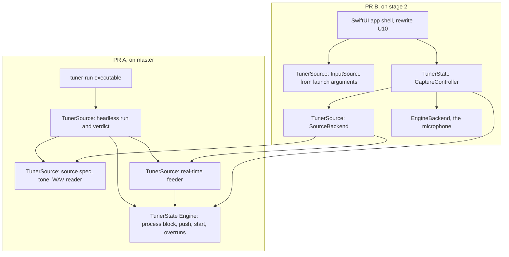
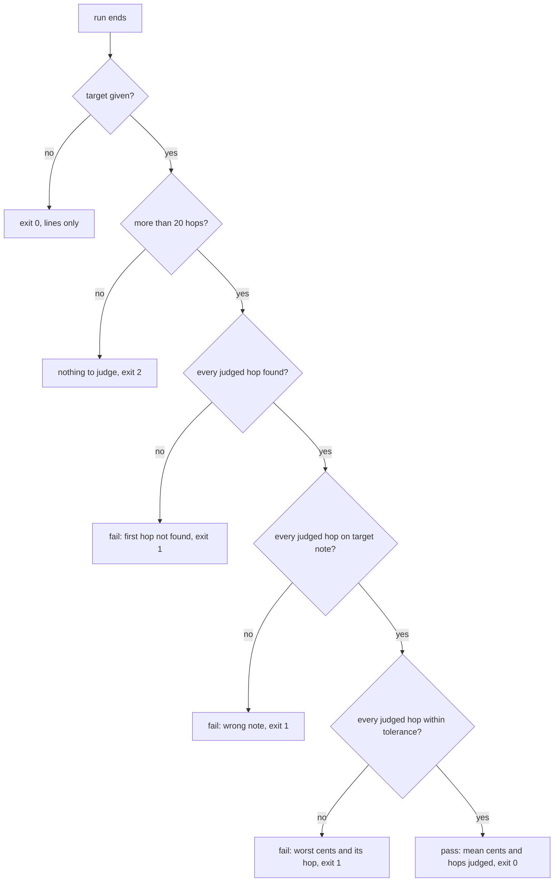

# Headless Audio Input - Plan

## Goal Capsule

- **Objective:** The owner can check that the tuner reads a known tone correctly, and can watch the app respond to canned sound, without speakers, the microphone, a quiet room or giving up the laptop. CI catches a reading that drifts.
- **Means:** One shared file-or-tone sound source with two front ends: a `tuner-run` command that prints readings and can pass or fail against a target, and a launch-time input source for the app that plugs into stage 2's capture controller as a backend (KTD1, KTD8).
- **Product authority:** The owner, who is the app's only user (STRATEGY.md). The Product Contract below wins on behaviour; the Planning Contract wins on mechanism.
- **Execution profile:** Two pull requests. PR A (U1 to U6) ships `tuner-run`, its library and the CI checks from `master`, together with this plan and `docs/ideation/2026-10-17-headless-audio-input-ideation.html`. PR B (U7, U8) stacks on stage 2: U7 needs the `CaptureBackend` protocol from `feat/stage2-bundle-capture`, and U8 needs the SwiftUI app shell from the rewrite plan's U10.
- **Stop conditions:** Stop and ask the owner if the Kirnberger III check in U6 fails against the app's own temperament table (see Risks), if stage 2 changes or drops `CaptureBackend` before PR B starts, or before launching Tuner.app on the owner's Mac.
- **Finishes and ships:** Each PR comes from a feature branch in a worktree, per AGENTS.md. PR B's branch is based on stage 2's branch, not on `master`, until stage 2 merges.
- **Open blockers:** None for PR A. PR B waits on stage 2 (see Dependencies).

---

## Product Contract

Product Contract preservation: changed, confirmed by the owner in planning: R2 (a note-name tone resolves once, at start), R6 (a judged reading must also be found and on the target note), R9 (the temperament check uses a note other than A), R13 (a hidden window pauses the file the way stage 2 pauses the mic). Added AE7 to AE9. The Dependencies entry on stage 2 now names the backend seam. No requirement was removed.

### Summary

Add a sound source that reads a WAV file or generates a tone, and feed it to the tuner engine in place of the microphone. The `tuner-run` command uses it to print one line of readings per hop and to pass or fail a cents target, and CI runs a few of those checks. The app accepts the same source at launch as a stage 2 capture backend, so the strobe, meter and readout can be watched on canned sound once the stage 2 app exists.

### Problem Frame

The only way to check that the tuner reads right is to play tones through the laptop's speakers into its microphone and watch the window. That takes the laptop over for the session, and the reading is only trustworthy in a quiet room, which a house with a newborn rarely is. One recorded attempt also failed because AirPods were the default input and output, so the tone never reached the built-in mic.

STRATEGY.md names "Tunes to a cent-offset target accurately" as a key metric, checked today by a manual test with a reference tone. Its "Engine correctness checks" track asks for a reference-tone harness so changes around the engine can be verified without ear-checking. The stage 1 rewrite added golden tests that prove the new engine matches the old one on synthesized input. But nothing runs a chosen tone with chosen settings and reports the reading. Nothing lets the running app take input from anywhere but the default microphone either.

### Key Decisions

- **One shared sound source, two front ends: a command and an app launch setting.** The command is the CI and analytics path. The app setting covers the visual check, and CI never launches the app. (session-settled: user-directed — chosen over a command-only first step and over making the app itself the headless command: it covers cents accuracy, the whole app on canned sound and a CI check, without starting an AppKit app in CI.) Governs R5–R13.
- **Both front ends in one plan.** They share the sound reader and the readings format, so splitting them would make the second plan re-decide the first's shared behaviour. (session-settled: user-directed — chosen over brainstorming the app input source alone: the owner asked for both.)
- **The command ships first.** It changes no capture code and delivers the cents check and CI on its own. (session-settled: user-approved — proposed with approach A, which named this order, and accepted.)
- **The app's input source is a stage 2 capture backend, and its launch flag lands with the stage 2 SwiftUI app.** (session-settled: user-directed — chosen over wiring `-InputSource` into today's AppKit `startAudio`, which stage 2 deletes, and over doing both: one implementation, at the cost of the visual check waiting for the stage 2 app.) Governs R10–R13.
- **The app's input source lasts for one launch.** A test run must never leave the app reading a file the next time the owner opens it to tune. Governs R11.
- **Files play at their own sample rate; nothing is resampled.** The engine already runs at 48 and 96 kHz, and accuracy at those rates is tested. Governs R3.
- **A file loops in the app and plays once in the command.** The window needs continuous input to be watched. The command needs a definite end to produce a verdict. Governs R7, R13.

### Requirements

**Sound sources (shared by both front ends)**

- R1. A sound source is either a WAV file or a generated tone, and both front ends accept the same source descriptions.
- R2. A tone is given either as a frequency in Hz or as a note name plus a cents offset, resolved once, when the source starts, against the reference, temperament and key in effect.
- R3. A file plays at its own sample rate, and the engine runs at that rate for the whole run.
- R4. A missing, unreadable or unsupported source stops the run with an error naming the source and the reason, in both front ends, and never falls back to the microphone.

**The `tuner-run` command**

- R5. `tuner-run` takes a source plus the settings the app passes to the engine (reference, temperament, key, filter, downsample, fundamental, note filter) and writes one JSON line per analysis hop: time, found, note, cents, measured frequency, reference frequency and count.
- R6. Given a target note, cents offset and tolerance, `tuner-run` prints a one-line verdict and exits with success only when every reading after settling is found, on the target note, and within tolerance of the target.
- R7. `tuner-run` reads the source once, runs faster than real time by default, and never opens an audio device or asks for microphone permission.
- R8. A paced mode feeds the source at real time through the same path the live app uses, and includes dropped blocks (overruns) in its output.
- R9. CI runs a small set of `tuner-run` tone checks on every pull request and fails the build when any check fails. The set includes at least one non-equal temperament with a cents offset on a note other than A, and one sample rate other than 44.1 kHz.

**The app's input source**

- R10. The app accepts an input source at launch, as `-InputSource file:<path>` or `-InputSource tone:<spec>`; without one, it captures from the default input as it does today.
- R11. The input source is not saved and not shown in Preferences, so the next plain launch captures from the default input.
- R12. With a file or tone source, the app never opens the microphone and never triggers a microphone permission prompt.
- R13. In the app, a file source plays at real-time pace and loops until the app quits. While the window is hidden it pauses, as stage 2 pauses the microphone, and it resumes from where it stopped.

### Key Flows

- F1. Check a cents target from the shell
  - **Trigger:** The owner, or CI, wants to know whether the tuner reads a tone correctly for a given temperament and offset.
  - **Steps:** Run `tuner-run` with a tone or file, the settings, and a target with tolerance; read the per-hop lines or just the verdict.
  - **Outcome:** A pass or fail with the measured cents, in seconds, with no sound played.
  - **Covered by:** R1, R2, R5, R6, R7, R9
- F2. Watch the app on canned sound
  - **Trigger:** The owner wants to see the strobe, meter and readout react, for example after a display change.
  - **Steps:** Launch the app with an input source; watch or capture the window; quit.
  - **Outcome:** The display moves as it would on that sound, the room stays silent, and the next plain launch uses the mic again.
  - **Covered by:** R10, R11, R12, R13

### Acceptance Examples

- AE1. **Covers R2, R6.** Given reference 440 Hz and equal temperament, when `tuner-run` runs a tone of A4 +7 cents with a target of A4 +7 cents ±0.5, then the verdict is a pass and shows a reading near +7.0 cents.
- AE2. **Covers R6.** Given the same tone, when the target is A4 +0 cents ±0.5, then the command exits with failure and the verdict shows the measured cents.
- AE3. **Covers R3.** Given a 48 kHz WAV of a steady 440 Hz tone, when `tuner-run` reads it, then the per-hop lines report about 440 Hz, A4 and near 0 cents.
- AE4. **Covers R10, R11.** Given the app was launched with `-InputSource file:take.wav` and then quit, when it is next opened from Finder, then it captures from the default microphone.
- AE5. **Covers R4.** Given a path that does not exist, when either front end is started with it, then the run stops with an error naming that path, and the microphone is not opened.
- AE6. **Covers R12.** Given a fresh build that has never been granted microphone access, when the app is launched with a tone source, then no permission prompt appears and the display responds to the tone.
- AE7. **Covers R2, R6, R9.** Given reference 440 Hz, Kirnberger III with key C, and a tone at E4's Kirnberger III frequency worked out from published ratios (about 3.4 cents below equal-tempered E4), when the target is E4 +0 ±0.5, then the verdict is a pass. Judged in equal temperament, the same tone fails.
- AE8. **Covers R6.** Given a source shorter than the settling period plus one hop, when `tuner-run` runs it with a target, then it reports that there is nothing to judge and exits with an error, not a pass.
- AE9. **Covers R12, R13.** Given the app captures from a file source, when the window is hidden for longer than stage 2's pause delay and then shown again, then playback resumes from where it stopped, and no microphone permission was asked for at any point.

### Success Criteria

- The STRATEGY.md manual check "Tunes to a cent-offset target accurately" can be done with one command, and CI repeats a version of it on every pull request.
- The owner can run a visual check while still using the laptop: nothing plays through the speakers, and the room's noise does not affect the result.

### Scope Boundaries

Deferred for later:

- Logging readings from the live app while it captures from the microphone.
- Selecting a capture device by ID, and a manual check of the real capture code through a loopback driver such as BlackHole.
- Recorded household-noise beds, signal-to-noise sweeps and real-instrument recordings.
- A scorecard beyond pass/fail (accuracy shares, lock time, false-found rates).
- Resampling files to another rate.
- Scripted changes to settings partway through a run.
- An on-screen marker in the app showing that it is reading a file or tone.

Outside this work:

- The Linux port (STRATEGY.md: no work on it).
- Testing the real microphone path. This work never exercises the capture code that talks to CoreAudio.
- An `-InputSource` flag for today's AppKit app. The stage 1 app keeps capturing from the default input only.

Considered and not built:

- A `--channel N` option. Channel 0 covers every file the owner has described; a stereo take with the signal only on the right channel would change this.
- Sample-rate limits or warnings beyond what the engine already rejects. Every source here is chosen by the owner or the CI script, so a strange rate shows up in the readings at once.
- Running paced mode in CI. Its timing depends on the runner, so it would fail for reasons unrelated to the engine.
- Overriding app settings at launch (`-temperament 1`). Launch arguments arrive as strings and `Settings.read` casts with `as? T`, so they are ignored today; only `InputSource` is read from launch arguments.

### Dependencies / Assumptions

- Stage 1 is merged (`16fd1d2`, PR #5): the app reaches the microphone through one capture call and builds the engine at the rate capture reports.
- Stage 2's capture controller and `CaptureBackend` protocol exist on `feat/stage2-bundle-capture` (`c89ac73`), unmerged, with its worktree in use by another session. The app input source is a second backend for that controller. Nothing in today's AppKit app uses the controller; the rewrite plan's U10 (the SwiftUI app shell) is the first app that does, and it does not exist yet.
- The rewrite plan's rule that tests never open an audio device still holds; nothing here changes it.
- Assumption: the smallest useful version is the printed reading against a target, which is why the command ships first. The owner skipped the question that would have confirmed this.
- Launching the app on the owner's Mac for a check still needs the owner's go-ahead each time.

### Sources / Research

- `swift/AppDelegate.swift` — `startAudio`: the single `CaptureCreate` call, and the engine created at `CaptureSampleRate(capture)`.
- `Sources/TunerCore/include/TunerCore.h` — `TunerSnapshot` fields, `TunerEngineProcessBlock` (caller's thread, bypasses the ring, refused while the analysis thread runs) and the single-consumer, newest-only `TunerEngineAcquire`.
- `Sources/TunerCore/analysis.c` (the reference-frequency block near `temperAdjust`) — temperaments are anchored on A, so A's reference frequency is the same in every temperament and key.
- `Sources/TunerState/Engine.swift` — the public wrapper: `init(sampleRate:temperaments:)`, `start(onHop:)`, `push`, `acquire` and the setters; `Hop.init(TunerSnapshot)` is internal and there is no per-block call or overrun count.
- `Sources/TunerState/Settings.swift` — writes only on change and only under its own keys, so a launch argument named `InputSource` is never persisted.
- `Sources/TunerState/Notes.swift` and `Sources/TunerState/Temperaments.swift` — note numbers (57 is A4), the frozen temperament order (index 1 is Kirnberger III, 8 is equal) and the ratio rows.
- `Tests/TunerCoreTests/Support/CoreRunner.swift`, `Support/RunningEngine.swift`, `Support/Fixture.swift` and `RateAccuracyTests.swift` — the fast path with every setting, the read-in-callback pattern, the 20-hop warm-up and the measured accuracy bounds (0.2 cents in general, up to 1.5 cents for 55 Hz at 96 kHz).
- `Tests/TunerCoreTests/RingTests.swift` — the per-block path and the threaded path produce bit-identical hops.
- `Sources/GoldenGenerator/generate.c` — tone synthesis from the absolute sample index in double precision, amplitude 0.5, and the `--flag value` argument style with usage exit 2.
- `Sources/TunerState/CaptureController.swift` and `Tests/TunerStateTests/CaptureControllerTests.swift` on `feat/stage2-bundle-capture` — the `CaptureBackend` protocol, the permission check in `begin`, the engine built at `inputSampleRate`, `stopCapture` stopping the backend before the engine, and the 3-second pause after the window is hidden.
- `docs/solutions/developer-experience/command-line-tools-swift-gaps.md` — tests run through `make test` with `TESTINGPLUGIN`; no `unsafeFlags` in any target.
- `docs/solutions/developer-experience/linker-signed-identifier-follows-product-name.md` — the `Tuner` product name must not change.
- `docs/plans/2026-10-16-1644-feat-mac-native-rewrite-plan.md` — KTD4 (no work in the audio callback), KTD8 (stage 2 capture), U10 (the SwiftUI app shell) and the rule that tests never open an audio device.
- `docs/ideation/2026-10-17-headless-audio-input-ideation.html` — the ideation run this plan came from, including the rejected alternatives.
- `STRATEGY.md` — the cent-offset key metric and the engine-correctness track.

---

## Planning Contract

### Key Technical Decisions

- KTD1. **A new library target, `TunerSource`, holds the sources, the headless run and, later, the app backend; it depends on `TunerState` and links AVFAudio.** It keeps file I/O out of the platform-free `TunerState` and out of `TunerCapture`, which is the device-capture leaf (rewrite plan KTD8). It is a target, not a library product, so the iOS-facing product list does not grow. Both front ends link it, so R1's shared descriptions hold by construction.
- KTD2. **`Engine` gains a public per-block call that returns a `Hop`, and a public overrun count.** `tuner-run`'s fast mode drives `TunerEngineProcessBlock` through it instead of calling `TunerCore` directly, so the existing setters apply the settings and the snapshot-to-`Hop` conversion stays in one place. The per-block path and the threaded path give bit-identical hops (`RingTests`), which is what lets fast mode stand in for the live app.
- KTD3. **Source descriptions are `file:<path>` and `tone:<pitch>[,rate=<Hz>][,amp=<0..1>][,secs=<s>]`.** Pitch is Hz (`440`, `329.6`) or a note name with an optional cents offset (`E4`, `Eb4+7`, `F#3-12.5`), with ASCII `#` and `b` and both spellings of each accidental. Defaults: 44100 Hz rate, amplitude 0.5 (the fixtures' level), 3 seconds in `tuner-run`, endless in the app. A cents offset beyond ±50 is an error, so the expected note is always the named one. A tone at or above half its sample rate is an error.
- KTD4. **A note-name tone uses the engine's reference formula, re-implemented in Swift from `Temperaments.values`; CI's temperament check does not use it.** The formula is the reference times `2^((note-57)/12)`, times the ratio of the temperament row to equal temperament between the note and A, rooted at the key. That makes `tone:Eb4+7` read +7 by construction, which is right for watching the app. The same reuse makes it circular as a check of the tables, so AE7 feeds a literal Hz worked out from published Kirnberger III ratios (KTD7).
- KTD5. **Files are read with `AVAudioFile` into memory as 32-bit float, channel 0.** It covers 16, 24 and 32-bit integer and float PCM, including extensible headers, with no hand-written RIFF parser. A file whose format is not PCM is an R4 error naming the format. A partial last block is dropped in `tuner-run`. In the app, the loop wraps sample-exact with no padding.
- KTD6. **The verdict skips 20 warm-up hops, then requires every remaining hop to be found, on the target note, and within tolerance (default ±0.5 cents).** Twenty hops is the golden tests' `Fixture.warmUpHops`; the first found reading would let a tone that never locks pass. Zero judged hops is an error (AE8). Exit codes follow the golden tools: 0 for a pass or a run with no target, 1 for a fail, 2 for a usage error, a source error or nothing to judge. JSON lines go to stdout and the verdict to stderr; `--quiet` drops the lines.
- KTD7. **CI runs `make tone-checks`: a shell table of `tuner-run` invocations, each asserting its exit code.** It follows `make fixtures` and `Scripts/fixtures.sh`: build the one product, then run a script under `set -euo pipefail`. It runs fast mode only, and every tone is at 110 Hz or above, where the measured accuracy is within 0.5 cents at every tested rate. The table covers AE1, AE2, AE7 in both temperaments, and one tone at 96 kHz. The expected E4 frequency for AE7 is a constant in the script with a comment citing its published source.
- KTD8. **The app backend implements stage 2's `CaptureBackend` and never asks for permission.** It reports `.granted`, never calls back on `onConfigurationChange`, and reports the source's rate as `inputSampleRate`, so `CaptureController.begin` goes straight to `startCapture` and builds the engine at the file's rate (R3, R12). It inherits the controller's lifecycle: hidden-window pause and resume, and the failure state the window shows (R4, R13).
- KTD9. **One real-time feeder serves both paced mode and the app backend.** A dedicated thread pushes 1024-sample blocks from a preallocated buffer into `Engine.push` against an absolute deadline, so pacing errors do not accumulate. Stopping it joins the thread before returning, so nothing pushes into an engine the controller then stops. It keeps its playhead across stop and start (R13). In paced `tuner-run`, hops are read inside the `onHop` callback, as `RunningEngine` does, and each line carries its hop number, so a skipped hop shows as a gap.
- KTD10. **JSON field names are readable rather than the golden fixtures' short names.** One line per hop: `hop`, `time`, `found`, `note`, `name`, `cents`, `frequency`, `reference`, `count`, plus `overruns` in paced mode. `time` is sample time (`hop × 1024 / rate`) in both modes, so fast output is deterministic. A hop that is not found writes `null` for the note, name, cents and frequencies. The golden `c` is in semitones; a `cents` field avoids that trap.
- KTD11. **`-InputSource` is read from the argument domain once at launch and never written.** The read happens in `TunerSource`, which the app calls when choosing its backend. `Settings` never sees the key, so R11 holds by construction and a test pins it.

### High-Level Technical Design

Components and data flow. PR A builds everything left of the dashed line; PR B adds the backend and wires it into the stage 2 app.

The verdict, applied after a fast or paced run:

### Sequencing

PR A (U1 to U6) lands on `master` first. Stage 2 then rebases onto `master`; that is the stage 2 owner's work, not this plan's. PR B starts from the rebased stage 2 branch: U7 can be built and tested as soon as `CaptureBackend` and `TunerSource` are on the same branch, but it ships in PR B together with U8, which merges after the rewrite plan's U10 exists.

---

## Implementation Units

### U1. Per-block call and overrun count on Engine

- **Goal:** `TunerState` callers can analyse one block on their own thread and get a `Hop`, and can read the overrun count.
- **Requirements:** R5, R7, R8; KTD2.
- **Dependencies:** None.
- **Files:** `Sources/TunerState/Engine.swift`, `Tests/TunerStateTests/EngineTests.swift`.
- **Approach:**
  1. Add a public per-block method that wraps `TunerEngineProcessBlock` and builds a `Hop` with the existing internal `Hop.init(TunerSnapshot)`; it throws `EngineError` when the core refuses, including while the analysis thread runs.
  2. Add a public overrun count read from the core.
- **Patterns to follow:** The existing setters and `acquire` in `Engine.swift`; `CoreRunner.runCore` for the per-block call sequence.
- **Test scenarios:**
  - The same 64 blocks of a 440 Hz sine, fed once through the per-block call and once through `push` with the thread running, give equal `Hop` values hop for hop.
  - The per-block call while the analysis thread runs throws, and the thread keeps running.
  - The overrun count is 0 after normal pushes and rises after a push larger than the ring.
- **Verification:** The new tests pass under `make test`, and existing engine tests are unchanged.

### U2. TunerSource target: source descriptions and tones

- **Goal:** One parser turns `file:` and `tone:` descriptions into a source, and a tone source produces samples at a known frequency.
- **Requirements:** R1, R2, R4; KTD1, KTD3, KTD4.
- **Dependencies:** None.
- **Files:** `Package.swift`, `Sources/TunerSource/SourceSpec.swift`, `Sources/TunerSource/Tone.swift`, `Tests/TunerSourceTests/SourceSpecTests.swift`, `Tests/TunerSourceTests/ToneTests.swift`.
- **Approach:**
  1. Add the `TunerSource` target (depends on `TunerState`, links AVFAudio) and a `TunerSourceTests` test target; no new library product, and no `unsafeFlags`.
  2. Parse descriptions per KTD3 into a value that names its kind, pitch and options; every parse error names the description and the reason (R4).
  3. Resolve a note name per KTD4 from a reference, temperament index and key passed in by the caller, not from `Settings`.
  4. Generate samples from the absolute sample index in double precision, rounded to float, into a caller-supplied block.
- **Patterns to follow:** `GoldenGenerator`'s tone synthesis; note numbers and pitch classes in `Notes.swift`; the GPL header and one-paragraph purpose comment on every file.
- **Test scenarios:**
  - `tone:440` gives 440 Hz at 44100 Hz, amplitude 0.5.
  - `tone:A4` at reference 440, equal temperament, gives 440 Hz; at reference 415 it gives 415 Hz.
  - `tone:Eb4+7` and `tone:D#4+7` resolve to the same frequency, 7 cents above equal-tempered E♭4.
  - `tone:E4` in Kirnberger III (index 1), key C, resolves to the app table's E4, and in every temperament `tone:A4` resolves to the reference.
  - `tone:E4,rate=96000,amp=0.25,secs=2` sets all three options.
  - `tone:E4+51`, `tone:H4`, `tone:30000,rate=44100`, `tone:` and `wave:x` are errors naming the description.
  - The generated block at sample index 10 000 000 matches `sin` computed directly at that index, so long tones do not drift.
- **Verification:** `make test` passes with the new test target included.

### U3. WAV file source

- **Goal:** A `file:` source reads a PCM file at its own rate into float samples from channel 0.
- **Requirements:** R1, R3, R4; KTD5.
- **Dependencies:** U2.
- **Files:** `Sources/TunerSource/FileSource.swift`, `Tests/TunerSourceTests/FileSourceTests.swift`.
- **Approach:**
  1. Open with `AVAudioFile`, read the whole file into a float buffer, keep channel 0 and the file's sample rate.
  2. Turn every open or read failure into an error naming the path and the reason; reject a format that is not PCM, naming it.
  3. Expose the samples as 1024-sample blocks, dropping a partial last block, plus a looping reader for the app.
- **Patterns to follow:** `SettingsTests` for per-test temporary state; tests write their WAVs to a temporary directory with `AVAudioFile` rather than committing fixtures.
- **Test scenarios:**
  - A 48 kHz 16-bit mono WAV of 440 Hz reads at 48000 Hz with samples matching the written ones to 16-bit precision.
  - A 32-bit float stereo WAV with a sine on the left and silence on the right reads the sine.
  - A 24-bit file reads at its own rate and values.
  - A file of 5000 samples yields 4 blocks.
  - The looping reader returns to sample 0 exactly after the last sample, with no padding.
  - Covers AE5. A missing path is an error naming the path; a text file renamed `.wav` is an error naming the path and the reason.
- **Verification:** `make test` passes; no test opens an audio device.

### U4. Headless run, feeder and verdict

- **Goal:** A source plus settings runs through the engine in fast or paced mode and yields per-hop records and, given a target, a verdict.
- **Requirements:** R5, R6, R7, R8; KTD2, KTD6, KTD9, KTD10.
- **Dependencies:** U1, U2, U3.
- **Files:** `Sources/TunerSource/HeadlessRun.swift`, `Sources/TunerSource/Feeder.swift`, `Sources/TunerSource/Verdict.swift`, `Sources/TunerSource/HopLine.swift`, `Tests/TunerSourceTests/HeadlessRunTests.swift`, `Tests/TunerSourceTests/VerdictTests.swift`, `Tests/TunerSourceTests/FeederTests.swift`.
- **Approach:**
  1. Build the engine at the source's rate and apply each setting through `Engine`'s setters; never construct `Settings`, which would read and write a defaults domain.
  2. Fast mode feeds every block through U1's per-block call.
  3. Paced mode starts the analysis thread, reads each hop inside `onHop`, and runs the feeder (KTD9) until the source ends, then reports the overrun count per line.
  4. The verdict follows KTD6 and the diagram above; it returns the outcome, the number of hops judged, and the worst or mean cents.
  5. One function renders a hop as a JSON line per KTD10 and the verdict as one line.
- **Execution note:** Write the verdict tests first; they pin the pass and fail rules that CI depends on.
- **Patterns to follow:** `RunningEngine` for reading inside the callback; `RateAccuracyTests` for parameterised cases with `CustomTestStringConvertible`.
- **Test scenarios:**
  - Covers AE1. A tone of A4 +7 in equal temperament, target A4 +7 ±0.5: pass, mean near +7.0.
  - Covers AE2. The same tone, target A4 +0 ±0.5: fail, reporting about +7 cents.
  - Covers AE7. A literal-Hz tone at Kirnberger III's E4, target E4 +0 ±0.5: pass in Kirnberger III with key C, fail in equal temperament.
  - Covers AE8. A 15-hop source with a target: nothing to judge.
  - A tone at A5 judged against A4: fail on the wrong note.
  - A tone that drops to silence after hop 30: fail on the first hop not found.
  - With no target, the run returns every hop and no verdict.
  - Fast mode output for a 3-second tone is identical across two runs.
  - A JSON line for a found hop has every KTD10 field; a hop not found has `null` for note, name, cents and frequencies.
  - Covers AE3. A temporary 48 kHz 16-bit mono WAV of 440 Hz, run in fast mode with no target, builds the engine at 48000 Hz and gives hops of about 440 Hz, note A4 and cents within 0.5 of zero.
  - The feeder, driven for a fixed number of blocks, delivers every block in order and ends at the source's end, and stop returns only after its thread exits.
  - A paced run of a short tone reports a hop number and an `overruns` field on every line.
- **Verification:** `make test` passes; fast-mode tests finish in well under a second each.

### U5. The tuner-run executable

- **Goal:** The owner and CI can run `tuner-run` from the shell with a source, settings and an optional target.
- **Requirements:** R5, R6, R7, R8; KTD6.
- **Dependencies:** U4.
- **Files:** `Package.swift`, `Sources/TunerRun/main.swift`, `Sources/TunerSource/RunOptions.swift`, `Tests/TunerSourceTests/RunOptionsTests.swift`.
- **Approach:**
  1. Add an executable target `TunerRun` with product name `tuner-run`; leave the `Tuner` product name alone.
  2. Parse `--flag value` arguments in `TunerSource` so they are testable: the source description, `--reference`, `--temperament` (index), `--key`, `--filter`, `--downsample`, `--fundamental`, `--note-filter` (turns the note filter on, as `CoreConfig`'s `note` does), `--notes` and `--octaves` (hex masks, as in `CoreConfig`), `--target <note><±cents>`, `--tolerance`, `--paced`, `--quiet`.
  3. `main.swift` only parses, runs, prints and exits with the code from KTD6; usage goes to stderr with exit 2.
- **Patterns to follow:** `GoldenGenerator`'s `main` and `usage` for argument and exit-code style.
- **Test scenarios:**
  - A full argument list parses into the expected settings, target and tolerance.
  - `--target E4` with no offset means +0 cents; `--target Eb4-3.5` parses both parts.
  - A missing source, an unknown flag, a flag without its value and `--temperament 32` are usage errors.
  - With no `--tolerance`, a target uses ±0.5 cents.
  - `--notes 0x200` alone leaves the note filter off; with `--note-filter` the filter is on with that mask.
- **Verification:** `swift build -c release --product tuner-run` produces `.build/release/tuner-run`; running it on `tone:A4+7 --target A4+7` prints a pass and exits 0.

### U6. CI tone checks and docs

- **Goal:** Every pull request runs a set of `tuner-run` checks, and a wrong reading fails the build.
- **Requirements:** R9; KTD7.
- **Dependencies:** U5.
- **Files:** `Makefile`, `Scripts/tone-checks.sh`, `.github/workflows/build.yml`, `AGENTS.md`.
- **Approach:**
  1. Add `make tone-checks`: build `--product tuner-run`, then run `Scripts/tone-checks.sh` with the binary's path.
  2. The script is a table of checks, each naming its source, settings, target and expected exit code; it prints one line per check and exits non-zero on the first mismatch.
  3. The rows: AE1 (expect 0), AE2 (expect 1), AE7 in Kirnberger III (expect 0) and in equal temperament (expect 1), and `tone:E4+5,rate=96000` against E4 +5 (expect 0).
  4. Add a CI step running `make tone-checks` after `make test` in `build-macos`.
  5. Add `make tone-checks` and a one-line `tuner-run` usage example to AGENTS.md's build commands.
- **Patterns to follow:** `make fixtures` and `Scripts/fixtures.sh` for the build-then-script shape and argument checks.
- **Test scenarios:** Test expectation: the script is the test. Its own check: change one expected exit code locally and confirm `make tone-checks` fails naming that row.
- **Verification:** `make tone-checks` passes locally and in CI on PR A.

### U7. SourceBackend for stage 2's capture controller

- **Goal:** Stage 2's `CaptureController` can run on a file or tone source in place of the microphone.
- **Requirements:** R3, R4, R12, R13; KTD8, KTD9.
- **Dependencies:** U2, U3, U4 (the feeder), and `CaptureBackend` from `feat/stage2-bundle-capture` on the same branch.
- **Files:** `Sources/TunerSource/SourceBackend.swift`, `Sources/TunerState/CaptureController.swift`, `Tests/TunerSourceTests/SourceBackendTests.swift`.
- **Approach:**
  1. Implement `CaptureBackend`: permission `.granted`; `requestPermission` answers true without any system call; `inputSampleRate` is the source's rate; `onConfigurationChange` is stored and never called.
  2. Construction takes the parsed source description plus the reference, temperament and key in effect, resolves a note-name tone from them once (R2), opens the source, and throws `CaptureError` with the source and reason; add a public message initialiser to `CaptureError` for that.
  3. `start` runs the feeder from the looping reader (a file) or the tone generator (a tone); `stop` joins it and keeps the playhead.
- **Patterns to follow:** `EngineBackend` in `CaptureController.swift`; `CaptureControllerTests` for driving the controller with an injected scheduler and visibility.
- **Test scenarios:**
  - Covers AE6. A controller with a tone backend reaches `.running(44100)` after `activate` and visible, and the backend's `requestPermission` was never called.
  - A 48 kHz file backend makes the controller build its engine at 48000 Hz.
  - Covers AE9. Hidden past `pauseAfter`, the controller reaches `.stopped`; shown again, it runs and the first block pushed starts at the stored playhead.
  - After the controller stops, no block is pushed (the feeder thread has exited before `engine.stop`).
  - Covers AE5. A missing path throws a `CaptureError` naming the path.
  - A file of 10 000 samples, fed for 30 blocks, wraps at the sample-exact position each time with no gap.
  - A `tone:E4` backend built with Kirnberger III, key C and reference 440 produces the app table's E4 frequency.
- **Verification:** `make test` passes on the stage 2 branch with these tests; no test opens an audio device.

### U8. The -InputSource launch flag in the stage 2 app

- **Goal:** The owner launches the stage 2 app with `-InputSource file:<path>` or `-InputSource tone:<spec>` and watches it respond, and the next plain launch uses the mic.
- **Requirements:** R10, R11, R12, R4; KTD11.
- **Dependencies:** U7, and the rewrite plan's U10 (the SwiftUI app shell that owns `CaptureController`).
- **Files:** `Sources/TunerSource/InputSource.swift`, `Tests/TunerSourceTests/InputSourceTests.swift`, the U10 app's capture setup under `Sources/TunerApp/` (path set by U10), and the stage 2 app's README.
- **Approach:**
  1. A function in `TunerSource` takes the argument-domain dictionary and returns no source, a source description, or an error for an empty value or unknown scheme. The app passes `UserDefaults.standard.volatileDomain(forName: UserDefaults.argumentDomain)`; tests pass literal dictionaries.
  2. The app's capture setup picks `SourceBackend` when a source is given, built with the app `Settings`' reference, temperament and key, and `EngineBackend` otherwise; a construction error goes to the same failure display U10 uses when `EngineBackend` fails to construct.
  3. Document the flag; that `file:` paths must be absolute, because an app started by `open` runs with `/` as its working directory; and that `open -n` or quitting first is needed because `open --args` passes nothing to a running instance.
- **Patterns to follow:** `SettingsTests` for an injected `UserDefaults(suiteName:)` with `removePersistentDomain`.
- **Test scenarios:**
  - With no `InputSource`, the function returns no source.
  - `file:/tmp/x.wav` and `tone:E4+5` return those descriptions.
  - An empty value and `mic:` are errors naming the value.
  - Covers AE4. After a `Settings` on a test suite runs a full change cycle, that suite's persistent domain has no `InputSource` key.
- **Verification:** `make test` passes. Then, with the owner's go-ahead each time, the owner runs AE4 (with an absolute file path) and AE6 on their Mac and confirms the display moves on a tone with no prompt and the next Finder launch uses the mic.

---

## Verification Contract

| Gate | Command or check | Proves | Units |
|---|---|---|---|
| Package tests | `make test` (debug, through `TESTINGPLUGIN` on the Command Line Tools) | R1–R8, R11, R12, R13, AE1–AE3, AE5, AE7–AE9 | U1–U5, U7, U8 |
| Release tests | `make test-release` | The same tests at the optimisation level the binaries ship with | U1–U5 |
| Tone checks | `make tone-checks` | R9, AE1, AE2, AE7 against the release binary | U6 |
| CI | `.github/workflows/build.yml` `build-macos` on each PR, with the new step after `make test` | R9 on every PR | U6 |
| Command smoke | `.build/release/tuner-run tone:A4+7 --target A4+7` exits 0; with `--target A4` exits 1 | R6, R7 by hand | U5 |
| Paced smoke | The owner runs `tuner-run tone:A4 --paced` by hand on an idle machine and sees no hop gaps and 0 overruns | R8 by hand | U4, U5 |
| Owner's visual check | Owner launches the stage 2 app with a tone and then a file source, then from Finder, after being asked | AE4, AE6, F2 | U8 |

No test or check opens an audio device or plays sound.

---

## Definition of Done

- PR A is merged: `make test` and `make tone-checks` pass locally and in CI, `make test-release` passes locally, and the PR includes this plan and the ideation page.
- PR B is merged after stage 2's capture controller and U10's app shell: `make test` passes on that branch, and the owner has run AE4 and AE6.
- Every unit's test scenarios exist and pass; each AE is covered by a test or by the owner's check.
- `AGENTS.md` lists `make tone-checks`, and the stage 2 app's README documents `-InputSource`.
- The `Tuner` product name is unchanged, and no target uses `unsafeFlags`.
- No dead-end or experimental code from abandoned approaches is left in either diff.

| Unit | Done when |
|---|---|
| U1 | The per-block call matches the threaded path hop for hop, and overruns are readable. |
| U2 | Every listed description parses or fails as specified. |
| U3 | AE5 passes on temporary WAVs, and every listed format reads at its own rate. |
| U4 | AE1, AE2, AE3, AE7 and AE8 pass in fast mode, and the feeder stops cleanly. |
| U5 | `tuner-run` builds and returns the KTD6 exit codes. |
| U6 | CI runs the tone checks and a broken row fails the job. |
| U7 | The controller runs on a source with no permission request and resumes at the playhead. |
| U8 | The flag selects the backend, is never persisted, and the owner's check passes. |

---

## Risks

- **The app's Kirnberger III row may not match the published ratios.** The tables come from Bill Farmer's `Temperaments.h`. If AE7 fails against the app's table, that is a finding about the table, not about the check: stop and ask the owner before changing either.
- **Stage 2 is in flight in another session.** Its controller API may change before PR B starts, and its rebase onto `master` after PR A may conflict in `Package.swift` and `Engine.swift`. PR A keeps its `Engine` change additive to keep that rebase small.
- **Accelerate can differ in the last bits across machines.** The ±0.5 cent tolerance absorbs it; fast mode is deterministic only on one machine, so no check compares exact cents across machines.
- **The visual check waits on the rewrite plan's U10.** Until it exists, F2 cannot be run; `tuner-run` covers the accuracy half meanwhile.
