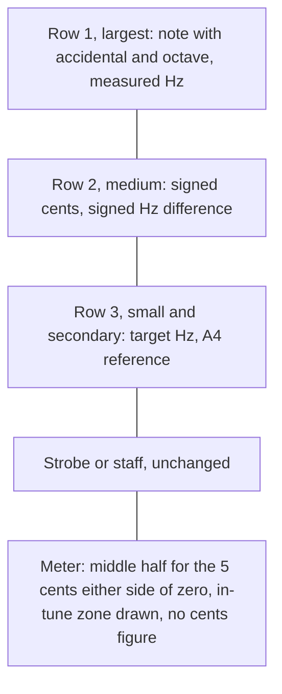
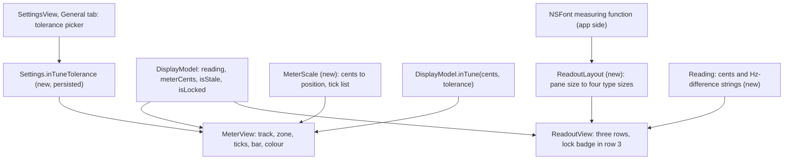

# Readout Cents and Meter Scale - Plan

## Goal Capsule

- **Objective:** While tuning one note, the owner reads the note, the measured Hz and how far off the note is, in cents and in Hz, from the readout at any window size, and sees the last few cents on the meter.
- **Means:** A second readout row for the two deviations, a meter scale that gives half its width to the 5 cents either side of zero with the in-tune zone drawn on it, and a setting for the in-tune tolerance (Key Decisions; KTD1, KTD3, KTD5).
- **Product authority:** This plan amends R9 of `docs/plans/2026-10-16-1644-feat-mac-native-rewrite-plan.md` and the readout and meter design that PR #2 set. Cents move from under the meter into the readout, and the in-tune tolerance becomes a setting. The rest of that plan stands. Requirements win on product behaviour, KTDs on mechanism.
- **Execution profile:** One pull request against `master` from a feature branch in a git worktree, per `AGENTS.md`. U1, U2 and U4 have no dependencies on each other, U3 needs U1 and U2, and U5 needs U4.
- **Stop conditions:** Stop and ask the owner if the running app still cuts off a readout row after one correction to the font measurement, if the owner rejects the look of the readout or the meter, or if idle CPU on the branch reaches 5% of one core.
- **Who finishes:** `ce-work` implements and verifies, `ce-commit-push-pr` opens the pull request, and the owner looks at the running app and merges.
- **Open blockers:** none.

---

## Product Contract

**Product Contract preservation:** Product Contract unchanged except two places. Outstanding Questions' four planning questions are now answered by KTD1, KTD2, KTD3 and KTD5. Scope Boundaries gains a list of things considered and not built.

### Summary

The single-note readout gains a second row with the signed cents and the signed Hz difference. Its target and A4 reference move to one small row, so no row is cut off. The meter's middle half covers the 5 cents either side of zero, with the in-tune zone drawn on it, and a new setting chooses the in-tune tolerance: 1, 2 or 5 cents.

The work ships as one pull request. Two small Foundation-only types in `TunerState` hold the arithmetic: one maps cents onto the meter's scale and one sizes the readout's type from the pane. Unit tests cover them, the setting and the new figure formats, and the views are checked on the running app.

### Problem Frame

The owner tunes by reading the Hz, the cents, or both. In single-note mode the readout shows the note, the measured Hz, the target, the Hz difference and the A4 reference, all in bold, and no cents. The cents appear only as the smallest text in the window, under the meter bar. At the default window size the pane below cuts off the readout's third row, and with the inspector closed it cuts through the middle of the letters.

The meter's scale is linear over 50 cents either side of zero. The in-tune zone, 5 cents either side, is a tenth of the track, and a reading of 2 cents is a bar 2% of the track's width. The last few cents decide whether a note is done, and they get the least room. The 5-cent rule is fixed, which is coarse for reed work and for tuning to a cent offset.

PR #2 made the measured Hz the large number and moved cents to the meter on 2026-10-17. That choice stays. It left the cents without a readable place.

### Key Decisions

- **Hz stays the leading figure, and the two deviations take the second row.** (session-settled: user-directed — chosen over cents beside the note, cents as the leading figure, and cents and Hz as an equal pair: the owner reads Hz, cents or both, and picked this arrangement from four sketches.) Governs R1, R2, R3, R4.
- **The meter uses an expanded-centre scale.** (session-settled: user-directed — chosen over a linear scale with the zone drawn, separate coarse and fine strips, and keeping today's meter: picked from sketches of each at 18, 3 and 0.6 cents.) Governs R7, R8, R9.
- **The in-tune tolerance is a setting of 1, 2 or 5 cents, default 5.** (session-settled: user-approved — chosen over a fixed 5 cents and over a tighter fixed value: 5 cents is coarse for reed work and cent-offset targets, and a default of 5 changes nothing until the owner picks.) Governs R15, R16, R17, R18.
- **The readout is the one place that prints cents in single-note mode.** The chosen layout sketch showed the meter without its figure, and two figures from differently smoothed values can disagree. Governs R2, R12.
- **The A4 reference stays in the readout, on the third row.** It needs no new place in the window. Governs R4.
- **Cents show one decimal place.** The meter's figure shows one today. Governs R19.
- **The scale's shape does not depend on the tolerance.** Only the drawn zone narrows, so the scale stays familiar when the setting changes. Governs R7, R10.
- **One plan covers the readout, the meter and the setting.** The owner named no smaller version when asked. Planning may still deliver them as separate pull requests.

### Requirements

**Readout, single-note mode**

- R1. The first row shows the note with its accidental and octave and the measured frequency, as it does today, and the measured frequency remains the largest figure.
- R2. A second row shows the signed deviation in cents under the note and the signed frequency difference in Hz under the measured frequency.
- R3. The second row's figures are smaller than the first row's and clearly larger than the third row's.
- R4. A third row shows the target frequency and the A4 reference in small, secondary text.
- R5. All three rows are fully visible at every window size from the minimum up, with the inspector open or closed.
- R6. The second row follows the readout's existing states: absent before the first reading, dimmed when the reading is stale, and held while the display is locked.



**Meter**

- R7. The scale gives its middle half to the 5 cents either side of zero, whatever the tolerance setting.
- R8. The outer quarters of the scale cover the range from 5 to 50 cents on each side.
- R9. Ticks are labelled at 1, 2, 5, 10, 20 and 50 cents on each side of zero.
- R10. The in-tune zone is drawn on the scale.
- R11. The bar is green while the reading is inside the zone, orange outside it and grey when the reading is stale.
- R12. The meter prints no cents figure.
- R13. A reading beyond 50 cents pins the bar at that end of the scale, as it does today.
- R14. In multiple-reed mode the meter follows R7 to R13.

Where a reading falls on the scale, as a share of the distance from the centre to the end:

| Reading | Today | With R7 and R8 |
|---|---|---|
| 1 cent | 2% | 10% |
| 2 cents | 4% | 20% |
| 5 cents | 10% | 50% |
| 10 cents | 20% | about 65% |
| 20 cents | 40% | about 80% |
| 50 cents | 100% | 100% |

The figures for 10 and 20 cents come from the logarithmic curve in the sketch the owner chose from.

**In-tune tolerance**

- R15. A setting chooses the in-tune tolerance from 1, 2 and 5 cents either side of zero, with 5 as the default.
- R16. A reading exactly at the tolerance counts as in tune.
- R17. The setting lives in the Settings window and persists across launches.
- R18. The zone (R10) and the bar's colour (R11) follow a change of the setting at once.

**Figure formats**

- R19. The cents figure shows one decimal place and the Hz difference shows two.

### Acceptance Examples

This work has no multi-step flow, so there is no Key Flows section. These examples cover its conditional cases.

- AE1. **Covers R2, R12, R19.** Given A4 sounding 2 cents sharp with the reference at 440 Hz, the second row reads "+2.0¢" and "+0.51 Hz", and no cents figure appears on the meter.
- AE2. **Covers R5.** Given a first launch at the default 640 by 440 window, and given a 920 by 564 window with the inspector closed, all three rows are fully visible. These are the two cases where the third row is cut off today.
- AE3. **Covers R7.** Given a reading of +5 cents, the bar reaches halfway from the centre to the end of the scale. Today it reaches a tenth of the way.
- AE4. **Covers R10, R11, R15, R18.** Given the tolerance set to 2 cents and a reading of +3 cents, the bar is orange and ends outside the drawn zone. When the tolerance changes to 5 cents, the zone widens and the bar turns green without a restart.
- AE5. **Covers R15, R16.** Given a first launch with no saved settings, the tolerance is 5 cents, and a reading of exactly +5.0 cents is in tune, as it is today.
- AE6. **Covers R6, R11.** Given a note that ended more than 1.5 seconds ago, the second row is dimmed with the rest of the readout and the meter bar is grey.
- AE7. **Covers R13.** Given a reading of +63 cents, the bar is pinned at the +50 end.

### Success Criteria

- The owner looks at the running app in the light and dark appearances, at the default window and a large one, and accepts the readout and the meter.
- Idle CPU stays under the rewrite plan's target of 5% of one core, checked with `make measure`.

### Scope Boundaries

- Not in this plan: a maximum type size for very large windows, an in-tune mark on the readout, and tolerance values other than 1, 2 and 5 cents.
- Unchanged: the multiple-reed rows, the strobe, the staff, the inspector, the toolbar, the pane clicks and the Copy Readout line.
- The other ideas in the ideation document stay separate work. The section below lists the ones that touch the same panes.

**Considered and not built**

- Drawing the meter's scale, ticks and zone in a canvas of their own so the 13 labels are not redrawn on every hop. In silence the meter does not redraw at all, so idle CPU does not depend on it. A `Scripts/measure.sh cpu` run with a tone playing that puts the branch clearly above `master` would change this.
- Holding the A4 figure under lock. Row 3 reads the reference from the live setting, as the readout does today, and R6 holds only the second row. A report of the A4 figure changing on a locked display would change this.
- Rounding the reading to one decimal before the in-tune comparison. KTD4 records why the colour follows the unrounded bar instead.
- Smoothing the meter more to calm the expanded centre, which shows jitter near zero 5 times larger than today. The owner judges the bar on the running app (Success Criteria). A rejection on those grounds would change this.

<!-- ce-section: work-relationships -->
### How This Work Fits Together

This plan covers the readout and the meter in single-note mode. The breakdown below is the current understanding from `docs/ideation/2026-11-10-tuner-ui-ux-look-and-feel-ideation.html`, not a committed roadmap.

- A line that names the tuning standard (idea 3). Can proceed independently of this plan. Still to decide: whether it takes the A4 reference from the readout's third row (R4).
- A display of what the app is hearing (idea 2). Shares the readout and meter panes. Can proceed independently of this plan.
- A settled result that stays when the note ends (idea 5). Shares the readout's stale state (R6).
- Target offsets (idea 7). Depends on the drawn zone and the tolerance (R10, R15) if "in tune" is to be measured from a target.

### Dependencies / Assumptions

- No automated test covers the views in `Sources/TunerApp`, so the result needs a look at the running app. Launching the app on the owner's Mac needs the owner's go-ahead each time.

### Outstanding Questions

**Resolve Before Planning**

None.

**Deferred to Planning**

All four are answered in the Planning Contract.

- The exact curve of the scale between 5 and 50 cents: KTD1.
- How the readout's type sizes are derived so that R5 holds: KTD5.
- Which Settings tab holds the tolerance: KTD3.
- Which tick labels drop if they do not fit at the minimum window width: none drop (KTD2).

### Sources / Research

- `docs/ideation/2026-11-10-tuner-ui-ux-look-and-feel-ideation.html`, idea 1: the evidence, a screenshot of the cut-off row, and the alternatives that were rejected.
- `Sources/TunerApp/Panes/ReadoutView.swift`: the single-note layout (lines 79-146) and its sizes, which come from the pane's height (lines 89-99). The point sizes add up to 0.9 of the pane height and SF lines are about 1.2 times the point size, so the three rows need about 1.08 times the pane height whenever the width does not limit them. The lock badge is an overlay at the bottom-leading corner (lines 60-68).
- `Sources/TunerApp/Panes/MeterView.swift`: the linear scale (line 61), the ticks (line 76), the clamp at 50 cents (line 98), the bar colours (lines 101-103) and the cents figure (lines 114-118).
- `Sources/TunerState/DisplayModel.swift`: `inTuneCents` (line 109), `inTune` (lines 162-165 and 183-186), and the 80 ms meter smoother (lines 230-235). The readout's `reading.cents` is the raw hop value refreshed at most every 100 ms; `meterCents` is smoothed.
- `Tests/TunerStateTests/DisplayModelTests.swift`: `inTuneWithinFiveCentsInclusive` (lines 366-384) pins the inclusive 5-cent rule that R15 and R16 generalise.
- `Sources/TunerState/Settings.swift` and `Sources/TunerApp/SettingsView.swift`: where settings are stored and shown. `Settings.read` (line 379) casts saved values with `as? T`.
- `Sources/TunerApp/TunerPanes.swift` (lines 36 and 57), `Sources/TunerApp/RootView.swift` (line 87) and `Sources/TunerApp/TunerApp.swift` (line 36): the readout's 192 pt minimum height, the meter's 48 to 72 pt height, the 560 by 360 minimum main area and the 640 by 440 default window. The readout sits at its 192 pt minimum at both the default and the minimum window.
- `Sources/TunerCore/analysis.c` (lines 364-366): a hop more than 0.6 semitones from its note is not found, so a displayed reading never exceeds 60 cents. `Sources/TunerCore/include/TunerCore.h` (line 55): nine octaves, so the highest note is B8 at about 7902 Hz.
- `Package.swift` (line 27): the package also targets iOS, so new `TunerState` types stay Foundation-only, with `Double` rather than `CGFloat`, as `SpectrumAxis` does.
- `Sources/TunerSource/Verdict.swift` and `Sources/TunerSource/RunOptions.swift`: `tuner-run` already has an unrelated `--tolerance` for its pass/fail verdict.
- `docs/solutions/developer-experience/command-line-tools-swift-gaps.md`: view-local state uses the `LocalState` alias, and tests run through `make`.
- `docs/solutions/ui-bugs/appkit-views-draw-at-window-size-from-dirtyrect.md`: size each pane from its own geometry and look at the minimum window, because neither the build nor CI caught the last sizing bug.
- `docs/solutions/performance-issues/top-cpu-samples-trailing-space.md` and `Scripts/measure.sh`: the CPU recipe.
- `docs/plans/2026-10-16-1644-feat-mac-native-rewrite-plan.md`: R9 (line 87) and the PR #2 design (line 248), which this plan amends, R21 and AE3 (lines 129 and 184) for the idle CPU target, and R35 (line 152) for the stale state.
- The layout and scale sketches the owner chose from, machine-local and best effort: `/tmp/compound-engineering-502/ce-brainstorm-visual/54ca20ae/screens/001-readout-layout.html` (option A) and `002-meter-scale.html` in the same directory (option B). Option A's readout used type at 64, 50, 36 and 14 px; option B's tick positions fit the curve in KTD1. They are temporary. If they are gone, nothing is blocked, and the requirements above govern any disagreement.

---

## Planning Contract

### Key Technical Decisions

- KTD1. **The scale is linear inside ±5 cents and logarithmic from 5 to 50.** A reading c within ±5 cents sits at c/10 of the half track; beyond that it sits at 0.5 + 0.5·log10(|c|/5), signed, and anything past ±50 sits at the end. This reproduces the owner's sketch: 10 cents at 65.1%, 18 at 77.8%, 20 at 80.1%. The bar moves more slowly per cent just outside ±5 cents than inside. The mapping lives in a new Foundation-only `MeterScale` in `TunerState`, so the arithmetic has tests although the views have none. (session-settled: user-directed — chosen over a linear scale with the zone drawn, separate coarse and fine strips, and keeping today's meter: picked from sketches of each at 18, 3 and 0.6 cents.) Governs R7, R8, R13.
- KTD2. **Every labelled tick is drawn at every window width, and no label is dropped.** The ticks sit at 0, ±1, ±2, ±5, ±10, ±20 and ±50. At the 560 pt minimum main area and the meter's largest label size of 14.4 pt, the closest pair, +1 and +2, sits about 25 pt apart, leaving about 7 pt between them. The running app confirms this at the minimum window. Governs R9.
- KTD3. **The tolerance is an `Int` setting named `inTuneTolerance`, shown on the Settings window's General tab.** It is stored under a new key of the same name with no legacy key. Its choices, 1, 2 and 5, are a static list beside `referenceRange`. A saved value outside the list reads as 5, and an assignment outside it is not stored, following the other settings' clamping. It is display-only, so it is not forwarded to the engine. The name keeps it apart from `tuner-run`'s `--tolerance`. General holds it because it concerns tuning, not the strobe. (session-settled: user-approved — chosen over a fixed 5 cents and over a tighter fixed value: 5 cents is coarse for reed work and cent-offset targets, and a default of 5 changes nothing until the owner picks.) Governs R15, R17.
- KTD4. **The in-tune rule takes the tolerance as an argument and compares the unrounded, smoothed meter value.** `DisplayModel.inTune(_:tolerance:)` replaces `inTuneCents` and the one-argument rule. The instance `inTune` property, which only tests use, is removed. The meter reads the setting in its body, so a change redraws the zone and the colour in every state, locked and stale included. The colour therefore always agrees with where the bar ends against the zone. Near the edge the readout's raw figure can show "+1.0¢" beside an orange bar. (session-settled: user-approved — chosen over rounding to one decimal before comparing: the colour must match the bar the owner sees against the drawn zone.) Governs R11, R16, R18.
- KTD5. **The readout's four type sizes come from one scale factor applied to the chosen sketch's proportions.** The proportions are note 64, Hz 50, second row 36 and third row 14. The octave and accidental stay at half the note's size. The factor is the smaller of two fits:
  1. The height fit makes the three rows' line heights plus two 4 pt gaps equal the pane height.
  2. The width fit makes each row's widest strings (KTD6), laid side by side with an 8 pt minimum gap between them, fit the pane width.

  At the default window, where the pane is 192 pt high and height-limited, this gives roughly an 87 pt note, 68 pt Hz, 49 pt second row and 19 pt third row. A new Foundation-only `ReadoutLayout` in `TunerState` does the arithmetic through a measuring function it is given: line height and string width at a size and weight. The app passes one built on `NSFont`, and the tests pass a fake. Measuring at each candidate size, rather than scaling one measurement, matters because SF changes its optical size near 20 pt, where the third row sits, so its widths are not proportional to size. (session-settled: user-approved — chosen over today's per-row fractions where only the Hz shrinks to fit the width: every size shrinks together in a narrow window, so the proportions, and R3, hold at every size.) Governs R3, R5.
- KTD6. **The readout is sized from fixed widest-case strings, so its type does not change size from note to note.** Digits are monospaced, so 8 stands for any digit.
  - Hz: "8888.88 Hz", since the highest note, B8, is about 7902 Hz.
  - Second row: "-60.0¢" and "-888.88 Hz". The engine drops a reading beyond 60 cents (`analysis.c`), and 60 cents of B8 is about 279 Hz.
  - Third row: "target 8888.88 Hz", room for the lock badge, and "A4 = 888.88 Hz".
  - Note: the widest note letter, plus an octave digit and an accidental at half size.

  Governs R5.
- KTD7. **In single-note mode the lock badge moves into the third row, between the target and the A4 figure.** At the bottom-leading corner it would cover the target once three rows fill the pane. Multiple-reed mode keeps the corner overlay. (session-settled: user-approved — chosen over the bottom-leading overlay, which covers the third row.) Governs R5, R6.
- KTD8. **The two second-row strings are `Reading` properties in `TunerState`, next to `copyLine`.** Cents print as `%+.1f¢` and the Hz difference as `%+.2f Hz`. The printf sign is kept, so a reading a hair flat prints "-0.0¢" next to "-0.00 Hz", as today's copy line does. (session-settled: user-approved — chosen over forcing a zero to print "+0.0¢": the sign then agrees with the Hz difference beside it.) Governs R2, R19.

### High-Level Technical Design

Who reads what. Views read observable state in their body, as `MeterView` does today, so changes to the setting, the meter value or the pane size redraw them. The two new types hold arithmetic only.



How `ReadoutLayout` finds its scale factor, as directional pseudo-code rather than an implementation:

```text
proportions = note 64, hz 50, row2 36, row3 14
k_height = largest k with
    lineHeight(note at 64k, bold) + lineHeight(row2 at 36k, bold)
    + lineHeight(row3 at 14k, regular) + 2 * 4  <=  pane height
k = k_height
repeat until every row fits (one pass when widths are proportional to size;
                             more only for SF's wider tracking below 20 pt):
    for each row:
        text = sum of its widest strings measured at its size under k
        gaps = its fixed 8 pt gaps
        if text + gaps is wider than the pane:
            k = k * (pane width - gaps) / text      (only the strings scale with k)
sizes = proportions * k
```

### Implementation Constraints

- New `TunerState` types use Foundation and `Double` only: no SwiftUI, AppKit or `CGFloat`, because the package also targets iOS.
- View-local state uses the `LocalState` alias, since the Command Line Tools lack the `@State` macro.
- Files that import both SwiftUI and `TunerState` write `TunerState.Settings`.
- No target may use `unsafeFlags`.
- Tests run through `make`, never bare `swift test`.

### Risks

- **The `NSFont` line height or width differs from what SwiftUI's `Text` lays out, so a row still clips although the tests pass.** AE2 is checked on the running app at both window sizes, locked and unlocked. One correction to the measuring function is allowed before the stop condition applies.
- **The expanded centre makes jitter near zero 5 times more visible.** The owner judges the bar on the running app. More smoothing is recorded as considered and not built.
- **Thirteen labels drawn per hop raise CPU while a note plays.** Idle is unaffected. A run with a tone playing is recorded against `master` as information.

---

## Implementation Units

### U1. Meter scale arithmetic

- **Goal:** A tested type that maps cents onto the expanded-centre scale and lists the labelled ticks.
- **Requirements:** R7, R8, R9, R13; AE3, AE7; KTD1, KTD2.
- **Dependencies:** none.
- **Files:** `Sources/TunerState/MeterScale.swift` (new), `Tests/TunerStateTests/MeterScaleTests.swift` (new).
- **Approach:** It returns a signed share of the half track for a cents value, clamped to ±1, and the 13 ticks with their value, position and label ("0", then signed labels such as "+1" and "-50"). The view multiplies the share by its own half width.
- **Patterns to follow:** `Sources/TunerState/SpectrumAxis.swift` and `Tests/TunerStateTests/SpectrumAxisTests.swift` (Swift Testing, `@Test` with arguments).
- **Test scenarios:**
  - Covers AE3. +5 cents maps to 0.5 and -5 to -0.5.
  - 0, 1 and 2 cents map to 0, 0.1 and 0.2.
  - 10, 20 and 50 cents map to about 0.651, 0.801 and 1.0, matching the table under Requirements.
  - Covers AE7. +63 cents maps to 1.0 and -63 to -1.0.
  - The mapping is continuous at ±5 (4.999 and 5.001 both within 0.001 of 0.5) and rises steadily across a sweep from -60 to +60.
  - The mapping is odd: the value for -c is minus the value for c.
  - The tick list holds 13 ticks from -50 to +50 in order, each placed where the mapping puts its value, labelled with a sign except "0".
- **Seam:** these tests catch errors in the arithmetic and the tick list. They miss how the view draws them.
- **Verification:** the new tests pass under `make test` and `make test-release`.

### U2. In-tune tolerance setting and rule

- **Goal:** A persisted tolerance setting, an in-tune rule that takes it, and a picker in the Settings window.
- **Requirements:** R15, R16, R17; AE5; KTD3, KTD4.
- **Dependencies:** none.
- **Files:** `Sources/TunerState/Settings.swift`, `Sources/TunerState/DisplayModel.swift`, `Sources/TunerApp/SettingsView.swift`, `App/README.md`, `Tests/TunerStateTests/SettingsTests.swift`, `Tests/TunerStateTests/DisplayModelTests.swift`.
- **Approach:**
  1. `Settings`: the stored property, its key, the static choices and the read-with-check in `init`, with no engine forwarding and no entry in `apply()`.
  2. `DisplayModel`: add `inTune(_:tolerance:)` and remove the instance property, which only tests use. `inTuneCents` and the one-argument rule stay until U3 moves the meter off them, so the package still builds after this unit.
  3. `SettingsView`: an "In-tune tolerance" picker on the General tab, offering "±1 cent", "±2 cents" and "±5 cents". Update the file's header comment.
  4. `App/README.md`: a feature line for the meter's in-tune zone and its 1, 2 or 5 cent tolerance.
- **Patterns to follow:** `reference` for reading a saved value with a check and a default, `colour` in `StrobeSettings` for a picker, and the existing round-trip tests in `SettingsTests`.
- **Test scenarios:**
  - Covers AE5. Fresh defaults give a tolerance of 5.
  - Each of 1, 2 and 5, once set, is read back by a new `Settings` on the same defaults.
  - A saved 3, 0 or -2, or a saved string, reads as 5.
  - Assigning 3 leaves the previous value in place and in the defaults.
  - Covers AE5. The rule, run over tolerances 1, 2 and 5, counts ±t and 0 as in tune and ±(t + 0.1) as out.
  - The current test's second half is rewritten to show the colour follows the smoothed value: after hops at 4.9 cents, `inTune(meterCents, tolerance: 5)` holds, and after hops at 5.1 it does not.
- **Verification:** the tests pass, and `make build` compiles the app.

### U3. Meter view

- **Goal:** The meter draws the expanded scale, its ticks and labels, and the in-tune zone, and colours the bar from the tolerance, with no cents figure.
- **Requirements:** R7 to R14, R18; AE3, AE4, AE6; KTD1, KTD2, KTD4.
- **Dependencies:** U1, U2.
- **Files:** `Sources/TunerApp/Panes/MeterView.swift`, `Sources/TunerState/DisplayModel.swift`.
- **Approach:**
  1. The body reads the tolerance beside `live`, `cents` and `stale`, so the drawing closure holds plain values and a change of setting redraws in every state.
  2. The bar's end, the ticks and the labels come from `MeterScale`. The bar keeps its 3 pt minimum width, its grey when stale and its per-hop redraw with no animation.
  3. The zone is drawn with the track, before the early return for a blank display, as a band behind the bar from minus to plus the tolerance. Its colour is a semantic one that reads in both appearances, chosen on the running app.
  4. The cents figure is removed, and its height goes to the track and the bar.
  5. The header comment cites this plan in place of R9.
  6. `DisplayModel.inTuneCents` and the one-argument `inTune` are removed once the meter no longer calls them (KTD4).
- **Patterns to follow:** today's `MeterView` canvas.
- **Test expectation:** none in code. No view has a test seam. U1 and U2 test the mapping and the rule, and the Verification Contract's running-app checks cover the drawing.
- **Verification:** `make build` compiles with no caller left on the removed members, and running-app checks 1, 2, 3 and 4 in the Verification Contract pass.

### U4. Readout type sizes and second-row strings

- **Goal:** Tested arithmetic for the readout's four type sizes and the two second-row strings.
- **Requirements:** R2, R3, R5, R19; AE1, AE2; KTD5, KTD6, KTD8.
- **Dependencies:** none.
- **Files:** `Sources/TunerState/ReadoutLayout.swift` (new), `Sources/TunerState/Notes.swift`, `Tests/TunerStateTests/ReadoutLayoutTests.swift` (new), `Tests/TunerStateTests/CopyFormatTests.swift`.
- **Approach:**
  1. `ReadoutLayout` takes the pane size and a measuring function and returns the note, Hz, second-row and third-row sizes per KTD5. Its widest-case strings (KTD6) are constants beside it.
  2. `Reading` gains the cents string and the Hz-difference string (KTD8).
  3. Only the pane size and the fonts set the sizes. No reading value enters them.
- **Execution note:** write the layout tests first against a fake measuring function shaped like SF Pro: line height about 1.19 times the size, widths proportional to size above 20 pt, and wider per point below it.
- **Test scenarios:**
  - At 540 by 192 the three line heights plus 8 pt fit within 192 and come within 2 pt of it, so the pane's room is used.
  - Across a sweep of widths from 540 to 2400 pt and heights from 192 to 1400 pt, the rows fit the height and each row's widest strings fit the width.
  - The sizes keep the proportions 64 : 50 : 36 : 14 throughout the sweep, so the second row is always smaller than the Hz and more than twice the third row (R3).
  - At 540 by 600 the width fit sets the sizes, and every row still fits the width.
  - With a fake whose widths grow faster below 20 pt, the third row still fits at the minimum pane. This catches scaling one measurement linearly.
  - Covers AE1. A4 at +2 cents, at 440 × 2^(2/1200) Hz against a 440 Hz target, gives "+2.0¢" and "+0.51 Hz".
  - A reading 12.34 cents flat and 3.456 Hz low gives "-12.3¢" and "-3.46 Hz".
  - A reading 0.04 cents flat and 0.004 Hz low gives "-0.0¢" and "-0.00 Hz".
  - A reading 60 cents flat at B8 gives strings no wider in characters than the widest-case strings `ReadoutLayout` sizes for.
- **Seam:** these tests catch errors in the sizing arithmetic and the formats. They miss any difference between the measuring function and SwiftUI's line layout, which only the running app shows.
- **Verification:** the new tests pass under `make test` and `make test-release`.

### U5. Readout view

- **Goal:** The single-note readout shows three rows sized by `ReadoutLayout`, with the lock badge in the third row.
- **Requirements:** R1 to R6; AE1, AE2, AE6; KTD5, KTD7.
- **Dependencies:** U4.
- **Files:** `Sources/TunerApp/Panes/ReadoutView.swift`, `AGENTS.md`.
- **Approach:**
  1. A measuring function built on the system font gives line height and string width at a size, weight and monospaced digits. The layout is worked out once per pane size, not on every reading.
  2. Row 1 keeps today's note, octave, accidental and Hz, at the new sizes.
  3. Row 2 puts the cents string under the note and the Hz-difference string under the Hz, in bold.
  4. Row 3 puts the target at the leading edge, the lock badge when locked, and the A4 figure at the trailing edge, in regular weight and the secondary colour.
  5. The bottom-leading badge overlay stays for multiple-reed mode only. `ReedRows` is otherwise unchanged.
  6. The header comment cites this plan.
  7. `AGENTS.md` names `MeterScale` and `ReadoutLayout` beside `SpectrumAxis` and `ScopeTrace`, as the `TunerState` types that hold pane arithmetic.
- **Patterns to follow:** today's `SingleReadout` structure and the stale dimming and lock handling in `ReadoutView`'s body, which already hold the second row's states (R6).
- **Test expectation:** none in code. No view has a test seam. U4 tests the arithmetic and the strings, and the running-app checks cover the drawing.
- **Verification:** running-app checks 1, 2 and 4 in the Verification Contract.

---

## Verification Contract

| Gate | How | Proves |
|---|---|---|
| Unit tests | `make test` | U1, U2 and U4 |
| Release tests | `make test-release` | The same at the shipped optimisation level |
| Sanitizers | `make sanitize` | The new `TunerState` code under address, undefined and thread sanitizers |
| App build | `make build`, then `make app` for the checks below | U3 and U5 compile with no caller left on the removed members |
| Running app | The checks below, after the owner's go-ahead for each launch | R1 to R18 on screen |
| Idle CPU | `Scripts/measure.sh cpu` on `master` and on the branch, in silence with the inspector hidden; confirm the output says "over 20 samples" | Under 5% of one core (Success Criteria) |
| CPU with a tone | The same recipe with a tone playing, on both builds | Recorded in the PR description for information, not a gate |
| CI | The pull request's checks | macOS and Linux builds, tests and tone checks |

Running-app checks. Use a throwaway copy of the bundle with its own bundle identifier, so the owner's settings stay untouched. Set the tolerance with a typed `defaults write <throwaway id> inTuneTolerance -int <n>`, because `Settings.read` would not accept a launch argument's string. Feed sound with `-InputSource tone:<spec>` or `file:<path>`. A `tone:` source never ends, so the display never goes stale with one. For check 4 and the stale half of check 3, use `file:` with the absolute path of a WAV in the scratchpad holding about 3 s of A4 at +3 cents and then about 10 s of silence. The app loops a file, so the display goes stale in every silent stretch. Screenshots go to the owner.

1. With `tone:A4+2`, the second row reads "+2.0¢" and "+0.51 Hz", the meter shows no figure, and the bar reaches a fifth of the half track (AE1, R7).
2. At 640 by 440 and at 920 by 564 with the inspector closed, all three rows are fully visible, both unlocked and locked (AE2, KTD7). At the minimum window, all 13 tick labels are legible and none overlap (KTD2).
3. With the tolerance at 2 and `tone:A4+3`, the bar is orange and ends outside the zone. Switching to 5 in the Settings window widens the zone and turns the bar green at once (AE4). Repeat the switch while locked and while stale, and the zone and colour still follow (R18).
4. After the sound stops for more than 1.5 seconds, the second row is dimmed with the readout and the bar is grey (AE6).
5. In light and dark appearance, at the default window and a large one, the owner accepts the readout and the meter (Success Criteria).

---

## Definition of Done

- Every requirement R1 to R19 holds. AE3, AE5 and AE7 pass as unit tests, and AE1, AE2, AE4 and AE6 pass on the running app.
- `make test`, `make test-release`, `make sanitize` and `make build` pass, and CI is green on the pull request.
- The owner has seen the running-app screenshots and accepted the readout and the meter. This is the gate on merging.
- Idle CPU on the branch is under 5% of one core, and the pull request description carries the idle and tone-playing figures for `master` and the branch.
- `App/README.md`, `AGENTS.md` and the header comments of `MeterView.swift`, `ReadoutView.swift` and `SettingsView.swift` describe the new behaviour.
- `DisplayModel.inTuneCents`, the one-argument `inTune` and the instance `inTune` are gone. No code from abandoned attempts is left in the diff.
- The work ships as one pull request against `master` from a worktree branch.

Per unit:

| Unit | Done when |
|---|---|
| U1 | `MeterScale` and its tests are in, and the tests pass |
| U2 | The setting persists, the rule takes it, the picker shows on General, and the tests pass |
| U3 | Running-app checks 1, 2, 3 and 4 pass for the meter |
| U4 | `ReadoutLayout`, the two strings and their tests are in, and the tests pass |
| U5 | Running-app checks 1, 2 and 4 pass for the readout, and `AGENTS.md` names the new types |
